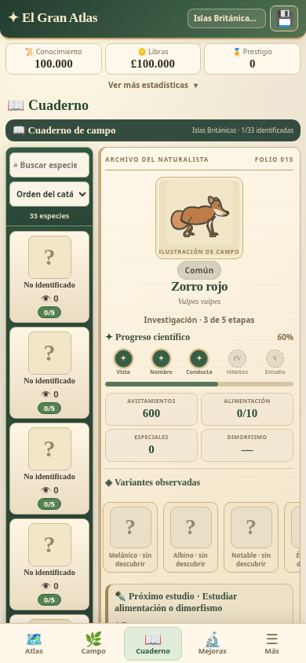
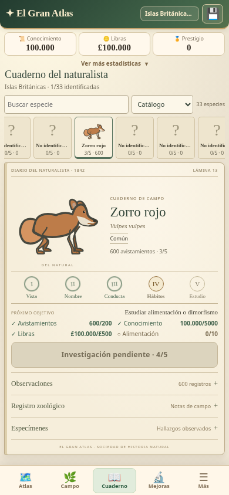

# El Gran Atlas v3.25.0 — Cuaderno del naturalista

Renovación visual y de navegación del Cuaderno: lámina zoológica protagonista, papel ligero, cinco sellos de investigación y objetivos legibles antes de las notas secundarias. El catálogo conserva **710 especies, 79 regiones y cinco continentes**.

- En móvil, selector horizontal de retratos, búsqueda por identidad conocida y orden por catálogo o avistamientos. Una sola lectura vertical; investigación accesible antes de los desplegables.
- En escritorio, directorio lateral y lámina editorial. Seleccionar una especie actualiza únicamente la ficha, conserva la búsqueda y la posición del selector.
- Los objetivos proceden directamente de `stageRequirements()`. Costes, umbrales, alimentación/dimorfismo, observación especial, recompensas y publicación permanecen idénticos.
- Los nombres, clasificación y ecología respetan los mismos umbrales. Los atributos de las ilustraciones no revelan perfiles científicos ocultos; no se cambia ningún trazo SVG.
- Solo aparecen variantes observadas. La comparación sexual conserva el motor y el ocultamiento individual existentes. El estudio 5/5 muestra su estado de publicación y conduce a Sociedad sin otorgar recompensas automáticamente.
- Estado visual temporal fuera de `gran_atlas_v05`. Exportación/importación, respaldos, actualización segura y todos los módulos anteriores conservados.

## Comparación visual

| Antes · 3.24.0 | Después · 3.25.0 |
| --- | --- |
|  |  |

[Comparación real en el laboratorio](docs/journal-v3250/comparison-laboratory.png) · [Sin descubrir](docs/journal-v3250/unknown-390.png) · [Investigación disponible](docs/journal-v3250/ready-390.png) · [Monografía completa](docs/journal-v3250/5-390.png) · [Publicada](docs/journal-v3250/published-390.png) · [Dimorfismo](docs/journal-v3250/dimorphism-detail.png) · [Variantes](docs/journal-v3250/variants-detail.png) · [Escritorio](docs/journal-v3250/desktop.png).

## Reglas e integridad

`tests/journal-v3250.test.cjs` compara el código completo de la aplicación con la instantánea publicada en 3.24.0: al retirar exclusivamente las inserciones de presentación 3.25, **todos los bytes originales coinciden**. Se mantienen las fixtures históricas de fauna, geografía, arte y progresión.

| Etapa | Avistamientos | Libras | Conocimiento | Requisito adicional |
| --- | ---: | ---: | ---: | --- |
| Vista | 10 | 10 | 100 | Ninguno |
| Nombre | 50 | 50 | 500 | Ninguno |
| Conducta | 100 | 100 | 1.000 | Ninguno |
| Hábitos | 200 | 500 | 5.000 | Diez observaciones de alimentación **o** ambos sexos cuando existe dimorfismo |
| Estudio | 500 | 1.000 | 10.000 | Una observación especial |

La identidad común se revela en la etapa 1; el nombre científico en la 2; horarios en la 3 y estaciones en la 4. La clasificación conserva sus reglas originales. Alcanzar 5/5 no publica ni entrega prestigio o dinero. La publicación manual conserva +1 prestigio y £90, una sola vez.

## Pruebas

**306 pruebas automatizadas aprobadas**, sin omitidas. Incluyen doce pruebas nuevas del Cuaderno y regresiones del catálogo mundial, las cinco etapas de las 710 especies, las 79 regiones, Museo, inventario, expediciones, variantes, dimorfismo, investigación y seis partidas históricas. Las comprobaciones de versión de suites anteriores se actualizan; sus fixtures y valores científicos no se alteran.

La prueba de navegador cubre **36 combinaciones de nueve estados y cuatro resoluciones**: 320 × 640, 360 × 740, 390 × 844 y 412 × 915. La acción principal queda sobre la navegación inferior, sin desbordamiento horizontal ni selector con desplazamiento vertical independiente. Siete regiones representan los cinco continentes, Amazonía (41 especies) y una región pequeña. Comprueba búsqueda, orden, selección, posición horizontal, regreso entre pestañas, avance real, publicación, variantes, sexos pendientes, movimiento reducido, recarga y uso offline.

Se utiliza **emulación de Chromium**, no un dispositivo Android físico. La recuperación tras teclado se comprueba reduciendo y restaurando la altura del viewport; no se afirma una prueba con un teclado Android real.

- [Informe de navegador y medidas por estado](docs/journal-v3250/browser-report.json).
- [Resultados de regresión](docs/journal-v3250/tests.txt).
- [Integridad y preservación de reglas](docs/journal-v3250/integrity-report.json).
- [Lista exacta de archivos](docs/journal-v3250/files.txt).
- [PWA 3.24.0 → 3.25.0](docs/journal-v3250/upgrade-3.24.0-report.json).
- [PWA 3.21.2 → 3.25.0](docs/journal-v3250/upgrade-3.21.2-report.json).

## Rendimiento

Medianas en el mismo Chromium, contexto, sesión CDP y CPU ×4; secuencia ABBA repetida dos veces, catálogo real de 710 especies y Amazonía con 41 especies. Temporizadores y workers se suspenden únicamente en el benchmark para aislar el coste visual de ambas versiones; sus funciones se prueban por separado.

| Operación | 3.24.0 | 3.25.0 |
| --- | ---: | ---: |
| Apertura con caché SVG fría | 197,55 ms | 169,55 ms |
| Reapertura con caché caliente | 92,05 ms | 81,10 ms |
| Selección de especie | 95,95 ms | 20,25 ms |
| Búsqueda | 12,20 ms | 9,95 ms |
| Cambio de orden | 90,95 ms | 73,70 ms |
| Despliegue de notas | 4,00 ms | 4,60 ms |
| Salida a Campo | 19,70 ms | 21,65 ms |
| Serialización | 1,44 ms | 1,42 ms |
| SVG en la primera apertura | 49,20 ms / 42 solicitudes | 49,75 ms / 41 solicitudes |
| Memoria JS tras GC | 3.461.304 bytes | 3.414.730 bytes |

La apertura mejora un 14,2 % y la selección un 78,9 %. Hay pequeñas variaciones al desplegar notas y salir a Campo; no se presenta una mejora uniforme. Los guardados de prueba miden 55.384–55.385 bytes en ambas versiones, con la variación del identificador de colección generado por el motor existente. No se incorporan campos permanentes ni temporizadores. [Ensayos y metodología completos](docs/journal-v3250/performance-report.json).

## Laboratorio

`www/laboratorio-cuaderno-v3250.html` permite cambiar estado, región, resolución y comparación. Usa las aplicaciones reales, los motores SVG y los estilos de producción. La referencia anterior conserva el `app.js` íntegro de 3.24.0 (`b35caa6`). Ambos marcos tienen origen opaco (`sandbox="allow-scripts"`, sin `allow-same-origin`), almacenamiento en memoria y ticks suspendidos. Los recursos se cargan desde el marco principal y se insertan íntegros para que la comparación funcione offline. No se cargan los gestores de exportación ni actualización en esos marcos.

## Archivos y reproducción

- Presentación: `www/js/journal-ui-v3250.js`, `www/css/journal-v3250.css`, inserciones acotadas en `www/js/app.js`.
- Laboratorio: HTML, controlador y referencia exacta en `www/js/lab/journal-*`.
- Pruebas: `tests/journal-v3250.test.cjs`, harness y normalizador histórico; aserciones de metadatos de las suites anteriores.
- Validación: `scripts/check-journal-browser-v3250.cjs`, `scripts/benchmark-journal-v3250.cjs`, `scripts/check-pwa-upgrade-v3250.cjs`, `scripts/verify-journal-apk-v3250.py`.
- Publicación: versión de paquete y Capacitor, índice, manifiesto de revisión, gestor de exportación (solo metadato de versión), registro del worker, enlace de actualización, entradas de actualización, service worker y workflows. El catálogo generado del laboratorio Atlas se sincroniza exclusivamente con la nueva envoltura HTML.
- Evidencias: `docs/journal-v3250/`. No se modifican catálogo, mallas, ilustraciones aprobadas, probabilidades, economía ni formato de guardado.

```sh
node --test tests/*.test.cjs
NODE_PATH=/workspace/atlas-tools/node_modules node scripts/check-journal-browser-v3250.cjs
NODE_PATH=/workspace/atlas-tools/node_modules node scripts/benchmark-journal-v3250.cjs
NODE_PATH=/workspace/atlas-tools/node_modules node scripts/check-pwa-upgrade-v3250.cjs
ATLAS_UPGRADE_FROM=3.21.2 NODE_PATH=/workspace/atlas-tools/node_modules node scripts/check-pwa-upgrade-v3250.cjs
```

## Publicación

Pendiente de verificar el commit, ambos workflows y el APK descargado. La comprobación nativa revisará versión 3.25.0/código 32500, ID de Capacitor estable, todos los recursos web y plugins de respaldo. El workflow usa firma de depuración: la compatibilidad con un APK instalado depende de conservar el certificado; no se garantiza hasta compararlos. Respalda siempre la partida antes de cualquier cambio de instalación.

- [Juego](https://pruizbohle.github.io/gran-atlas-naturaleza/).
- [Laboratorio](https://pruizbohle.github.io/gran-atlas-naturaleza/laboratorio-cuaderno-v3250.html).
- [Actualizar conservando la partida](https://pruizbohle.github.io/gran-atlas-naturaleza/actualizar-v3250.html).
