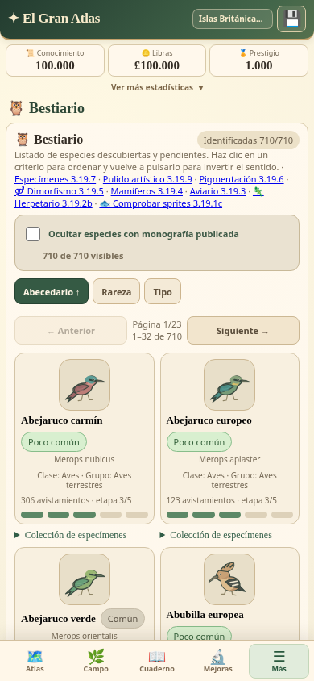
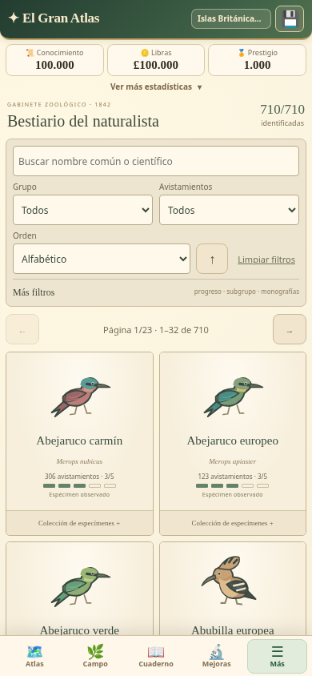

# El Gran Atlas v3.26.0 — Bestiario del naturalista

Colección ilustrada con búsqueda global, filtros combinables, fichas emergentes y rutas hacia Atlas y Campo. Se conservan **710 especies, 79 regiones, cinco continentes y 32 tarjetas por página**. No se modifican catálogo, ilustraciones aprobadas, mapas, economía, investigación ni reglas de exploración.

## Antes y después

| 3.25.0 | 3.26.0 |
| --- | --- |
|  |  |

[Comparación con los motores reales](docs/bestiary-v3260/comparison-laboratory.png) · [Sin descubrir](docs/bestiary-v3260/lab-undiscovered.png) · [Descubierta sin identificar](docs/bestiary-v3260/lab-observed.png) · [Nombre conocido, científico pendiente](docs/bestiary-v3260/lab-name.png) · [Ficha identificada](docs/bestiary-v3260/lab-latin.png) · [Monografía publicada](docs/bestiary-v3260/lab-published.png) · [Distribución múltiple](docs/bestiary-v3260/lab-distribution.png).

Las tarjetas tienen marco de papel, retrato, identidad disponible, avistamientos, cinco marcas de estudio y sello de publicación. Las incógnitas permanecen ocultas. El modal prioriza la ilustración y el registro, con distribución utilizable y notas secundarias desplegables.

## Búsqueda, filtros y orden

El procesamiento sigue **catálogo completo → filtros → orden → página → SVG visibles**. Los filtros funcionan conjuntamente y muestran el total de coincidencias. Limpiar restaura los criterios; una selección incompatible de subgrupo vuelve a Todos.

| Criterio | Opciones y regla |
| --- | --- |
| Búsqueda | Nombre común y científico conocidos; coincidencia parcial, sin distinción de mayúsculas o tildes |
| Grupo | Todos, Mamíferos, Aves, Reptiles y anfibios, Peces; mismas categorías de `bestiaryTypeBucket()` |
| Subgrupo | Valores reales de `taxonomyInfo()`, exclusivamente después de revelarse |
| Avistamientos | Todos, cero, ≥1, ≥10, ≥50, ≥100, ≥200, ≥500; contador real `sight(id)` |
| Progreso | Todas, no descubiertas, descubiertas, investigación incompleta, 5/5, monografía publicada |
| Monografías | Casilla independiente para ocultar las publicadas |
| Orden | Alfabético, rareza, tipo, avistamientos; ambos sentidos. Avistamientos comienza con las más vistas |

Los umbrales del filtro no cambian los requisitos científicos. Alfabéticamente, los animales observados preceden a las incógnitas en ambos sentidos; estas no se ordenan por su identidad oculta. El tipo se ordena mediante la clasificación ya conocida. Los subgrupos compatibles se conservan al cambiar de grupo.

[Ejemplo de filtros combinados](docs/bestiary-v3260/combined-filters.png). Las pruebas verifican los cuatro órdenes y ambos sentidos para las 710 identidades, todos los umbrales, resultados vacíos y acceso completo por 23 páginas.

Los criterios y el estado abierto/cerrado son temporales. Se leen las preferencias históricas existentes al iniciar, sin añadir campos ni escribir filtros nuevos en `gran_atlas_v05`. Cerrar conserva la misma página y desplazamiento; volver desde Atlas recupera criterios, orden y posición. Recargar inicia una sesión visual nueva y conserva todo el progreso.

## Descubrimiento progresivo

| Estado real | Información presentada |
| --- | --- |
| No descubierta | Incógnita, sin ilustración, ficha ni distribución específica |
| Observada, 0/5 | Ilustración observada, identidad reservada y distribución real |
| 1/5 | Nombre común y hábitats autorizados |
| 2/5 | Nombre científico y clase/grupo conocido |
| 3/5 | Subgrupo y horarios autorizados |
| 4/5 | Estaciones autorizadas |
| 5/5 | Estudio completo; publicación solo si existe en la partida |

Se utilizan `visibleName()`, `visibleLatin()`, `taxonomyText()` y las mismas puertas del Cuaderno. Las búsquedas nunca indexan nombres pendientes ni permiten filtrar por una clasificación todavía oculta. Las variantes y los sexos muestran únicamente registros obtenidos o su condición pendiente.

Se retiraron metadatos gráficos en la presentación, incluidos nombres científicos que aparecían dentro de IDs de recortes SVG. Las definiciones y sus referencias se renombran juntas mediante identificadores opacos únicos por ilustración. **Las 710 geometrías se comparan y todos los recortes conservan sus referencias válidas.** No se modifica ningún motor ni el Cuaderno 3.25.0.

## Ficha y navegación

El diálogo nativo tiene nombre accesible, cierre de 44 px siempre visible, Escape, toque exterior protegido frente a arrastres, retención del foco, bloqueo del fondo y restauración del elemento de origen. El contenido secundario se desplaza dentro del diálogo. Al cerrarlo se libera su contenido; no se precalculan fichas de otras especies.

La colección desplegable de cada tarjeta sigue cargándose bajo demanda. Conserva ilustraciones y registros de los especímenes observados. La ficha emergente muestra sus nombres y el dimorfismo registrado, con **una sola ilustración principal**, sin duplicar la galería de variantes. [Variantes](docs/bestiary-v3260/observed-variants.png) · [Dimorfismo registrado](docs/bestiary-v3260/recorded-dimorphism.png).

**Dónde encontrarla** deriva exclusivamente de `REGIONS[].species`. El índice inverso se construye una vez, al consultar la primera ficha, y elimina duplicados de presencia. Orden: región actual, rutas habilitadas, regiones disponibles para desbloquear, regiones bloqueadas.

- **Ya estás aquí:** permite volver a Campo.
- **Viajar a Campo:** vuelve a comprobar `regionAccessible()` y la presencia regional antes de llamar al `travelToRegion()` original.
- **Ver en Atlas / Ver requisitos:** selecciona continente y región, centra su hexágono y muestra los requisitos originales. No cambia la región actual, no desbloquea y no concede prestigio.
- **Abrir Cuaderno:** aparece exclusivamente si la especie pertenece a la región actual; el controlador vuelve a comprobarlo.

Los botones utilizan posiciones opacas, sin exponer IDs científicos. Se rechazan posiciones inválidas, regiones ajenas a la distribución y botones que quedaron desactualizados tras bloquearse una ruta. Norteamérica y Sudamérica mantienen sus investigaciones, mapas y umbrales originales. Una región disponible se desbloquea exclusivamente mediante el Atlas normal.

[Región habilitada](docs/bestiary-v3260/lab-unlocked.png) · [Destinos americanos bloqueados](docs/bestiary-v3260/lab-locked.png) · [Atlas seleccionado sin viaje](docs/bestiary-v3260/atlas-blocked-region.png). El [informe de navegador](docs/bestiary-v3260/browser-report.json) confirma tanto el viaje real autorizado como el rechazo del intento indebido y la recuperación de filtros, página y desplazamiento.

## Pruebas e integridad

**326 pruebas aprobadas, cero fallos y cero omitidas.** Veinte pruebas nuevas comprueban búsqueda, taxonomía progresiva, órdenes, filtros, paginación, SVG, distribución completa, persistencia, rutas válidas y bloqueadas. Las 306 pruebas anteriores siguen comprobando todas las regiones, las cinco etapas de las 710 especies, guardados históricos, Museo, inventario, expediciones, variantes y economía.

El `app.js` publicado en 3.25.0 se conserva íntegro como referencia. Al retirar exclusivamente las inserciones delimitadas `B-3260`, **el código original coincide byte a byte**. Las suites históricas conservan sus fixtures de fauna, arte, geometría y progresión; solamente cambian sus aserciones de metadatos de publicación. El harness histórico puede ejecutar la presentación anterior y las pruebas nuevas activan explícitamente el módulo 3.26. El navegador y el laboratorio ejecutan la presentación de producción.

[Resultados completos](docs/bestiary-v3260/tests.txt) · [Integridad](docs/bestiary-v3260/integrity-report.json) · [Archivos modificados](docs/bestiary-v3260/files.txt).

### Móvil y offline

Se probaron **320 × 640, 360 × 740, 390 × 844 y 412 × 915**, con los cuatro grupos: 16 combinaciones de modal, cierre, ilustración y ausencia de desbordamiento horizontal. Además: búsqueda, subgrupos, todos los umbrales, filtros conjuntos, 23 páginas, colecciones diferidas, foco, Escape, cierre exterior, desplazamiento, rutas, Cuaderno, recarga y guardado.

Se utiliza **emulación de Chromium, no un Android físico**. El catálogo admite desplazamiento vertical; la ficha conserva su cierre y sus acciones fuera de la navegación inferior.

El catálogo, las fichas y el laboratorio funcionan offline. La actualización segura se probó desde 3.25.0 y 3.21.2: worker anterior coherente hasta aceptación explícita, protección ante otras ventanas, respaldo exacto y conservación de la partida.

- [Informe responsive y funcional](docs/bestiary-v3260/browser-report.json).
- [PWA 3.25.0 → 3.26.0](docs/bestiary-v3260/upgrade-3.25.0-report.json).
- [PWA 3.21.2 → 3.26.0](docs/bestiary-v3260/upgrade-3.21.2-report.json).

## Rendimiento

Comparación con el mismo catálogo de 710 especies, 355 publicaciones y partida fija, mismo Chromium/contexto/página y CPU ×4. **ABBA repetido cuatro veces: 16 ensayos**. Workers bloqueados y callbacks periódicos suspendidos únicamente en el benchmark de ambas versiones; funcionamiento real y offline comprobados por separado. Se miden controladores de producción y layout forzado.

| Operación — mediana | 3.25.0 | 3.26.0 |
| --- | ---: | ---: |
| Apertura con SVG fríos | 204,65 ms | 218,05 ms |
| Reapertura caliente | 101,05 ms | 88,80 ms |
| Cambio de página | 139,90 ms | 114,70 ms |
| Cambio de orden | 130,40 ms | 79,30 ms |
| Ocultar publicaciones | 110,50 ms | 88,95 ms |
| Búsqueda | No existía | 28,65 ms |
| Grupo | No existía | 97,80 ms |
| Umbral de avistamientos | No existía | 88,30 ms |
| Abrir ficha | No existía | 41,30 ms |
| Cerrar ficha | No existía | 50,05 ms |
| Colección diferida, incluyendo espera de frame | 69,55 ms | 76,00 ms |
| Serialización de partida | 2,44 ms | 2,71 ms |
| Generación SVG en primera apertura | 68,10 ms | 66,50 ms |

Se mantienen exactamente **32 solicitudes SVG al abrir**, sin generar las 710 ilustraciones. La apertura fría añade 13,4 ms en esta prueba (+6,5 %); la reapertura mejora un 12,1 %, las páginas un 18,0 % y el orden un 39,2 %. No se presenta una mejora uniforme ni se oculta el coste inicial de preparar filtros.

El guardado mide **91.869 bytes en ambos casos**. La memoria JS tras el recorrido es 4.872.244 / 5.208.436 bytes; la versión nueva también ejercita filtros y fichas inexistentes antes y retiene más sprites en la caché compartida, por lo que esta cifra no representa exclusivamente el coste de presentación. No se agregan procesos periódicos ni cambios al tick. El índice y los listeners son acotados.

[Datos completos](docs/bestiary-v3260/performance-report.json) · [Tanda exploratoria conservada](docs/bestiary-v3260/performance-exploratory.json). El entorno mostró variaciones absolutas entre tandas; no se atribuyen esas diferencias entre sesiones a la optimización. La tabla usa los 16 ensayos de la tanda final, con las mismas condiciones para ambas versiones.

## Laboratorio independiente

`www/laboratorio-bestiario-v3260.html` incluye doce estados: no descubierta, observada sin identificar, nombre, nombre científico, estudio intermedio, 5/5, publicada, variantes, dimorfismo, distribución múltiple, ruta habilitada y destino americano bloqueado. Permite abrir/cerrar la ficha, escoger resolución y comparar con 3.25.0.

Ejecuta los motores reales en marcos de origen opaco (`sandbox="allow-scripts"`, sin `allow-same-origin`), almacenamiento en memoria y ticks suspendidos. Los archivos de producción se cargan e insertan completos desde el marco principal para funcionar también offline. No carga gestores de actualización ni exportación y no puede leer ni escribir una partida real.

## Archivos y reproducción

- Presentación: `www/js/bestiary-ui-v3260.js`, `www/css/bestiary-v3260.css` e inserciones acotadas en `www/js/app.js`.
- Laboratorio: `www/laboratorio-bestiario-v3260.html`, controlador y referencia 3.25.0 en `www/js/lab/bestiary-*`.
- Pruebas: `tests/bestiary-v3260.test.cjs`, harness, normalizador de alcance y aserciones de versión actuales de las suites anteriores.
- Validación: scripts `check-bestiary-browser-v3260.cjs`, `benchmark-bestiary-v3260.cjs`, `check-pwa-upgrade-v3260.cjs`, `verify-bestiary-apk-v3260.py`.
- Publicación: índice, versión de paquete/Capacitor, manifiesto de revisión, caché y entradas de actualización, metadato de exportación, registro del worker y workflows. El laboratorio Atlas generado se sincroniza con la envoltura HTML de la versión; su mapa no cambia.
- Evidencias: `docs/bestiary-v3260/`.

```sh
node --test tests/*.test.cjs
NODE_PATH=/workspace/atlas-tools/node_modules node scripts/check-bestiary-browser-v3260.cjs
NODE_PATH=/workspace/atlas-tools/node_modules node scripts/benchmark-bestiary-v3260.cjs
NODE_PATH=/workspace/atlas-tools/node_modules node scripts/check-pwa-upgrade-v3260.cjs
ATLAS_UPGRADE_FROM=3.21.2 NODE_PATH=/workspace/atlas-tools/node_modules node scripts/check-pwa-upgrade-v3260.cjs
```

## Publicación

Pendiente de verificar commit, ambos workflows y el APK descargado. Se comprobarán versión 3.26.0/código 32600, ID nativo estable, todos los archivos web y los plugins de respaldo. El workflow conserva el proceso de firma de depuración: la actualización directa de un APK depende de que coincida el certificado, por lo que se comparará con 3.25.0.

- [Juego](https://pruizbohle.github.io/gran-atlas-naturaleza/).
- [Laboratorio](https://pruizbohle.github.io/gran-atlas-naturaleza/laboratorio-bestiario-v3260.html).
- [Actualización segura](https://pruizbohle.github.io/gran-atlas-naturaleza/actualizar-v3260.html).
