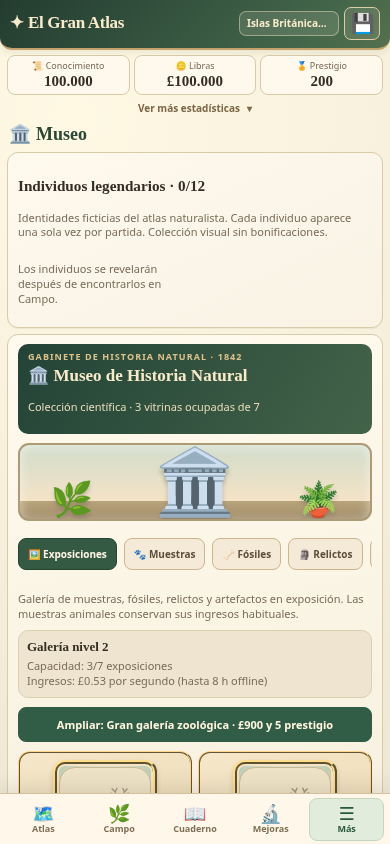
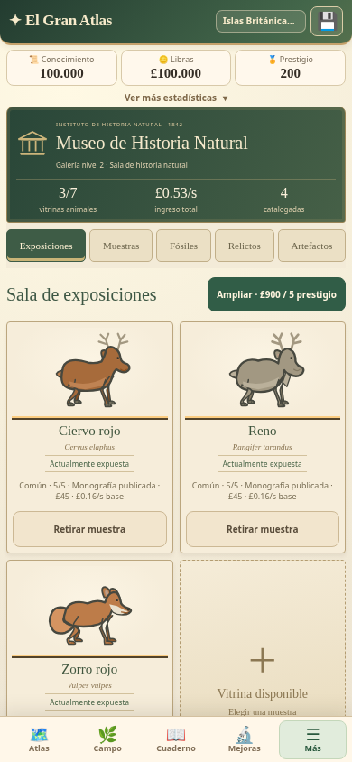

# El Gran Atlas v3.27.0 — Museo de Historia Natural

Renovación visual e interactiva de las **cinco salas originales**, con vitrinas ilustradas, fichas accesibles, materiales legibles y campañas con tiempo real. Se conservan **710 especies, 79 regiones**, las ilustraciones aprobadas y todas las reglas del juego.

## Comparación y capturas

| Museo 3.26.0 | Museo 3.27.0 |
| --- | --- |
|  |  |

[Comparación con ambos motores reales](docs/museum-v3270/comparison-laboratory.png) · [Ficha animal en 320 px](docs/museum-v3270/modal-exhibitions-320.png).

| Sala | Cambios y evidencia |
| --- | --- |
| Exposiciones | Vitrinas animales, espacios disponibles y gabinetes científicos independientes; [captura](docs/museum-v3270/after-exhibitions-390.png) |
| Muestras | Filtros de disponibilidad, exposición y cuatro grupos; orden económico en ambos sentidos o alfabético; 32 tarjetas por página; [captura](docs/museum-v3270/after-samples-390.png) |
| Fósiles | Ocho montajes, nueve componentes, cuatro registros y conservación; SVG secundarios bajo demanda; [captura](docs/museum-v3270/after-fossils-390.png) |
| Relictos | Nueve expedientes con tres indicios, identidad progresiva, prospecciones, conjuntos e hitos originales; [captura](docs/museum-v3270/after-relicts-390.png) |
| Artefactos | Cinco piezas históricas, recetas y existencia de piezas retiradas; [captura](docs/museum-v3270/after-artifacts-390.png) |

[Excavación activa](docs/museum-v3270/lab-dig-active.png) · [Excavación finalizada, sin autoentrega](docs/museum-v3270/excavation-ready.png) · [Reconstrucción terminada](docs/museum-v3270/lab-fossil-mounted.png) · [Relicto catalogado](docs/museum-v3270/lab-relict-owned.png) · [Conservación y conjuntos](docs/museum-v3270/conservation.png).

## Navegación e interacción

Cabecera institucional de 1842 con galería, capacidad, renta real y colecciones catalogadas. Papel, madera y latón mediante CSS/SVG locales; las ilustraciones originales conservan protagonismo. No se incorporan imágenes remotas ni dependencias de producción.

Las fichas muestran únicamente piezas disponibles, con ilustración ampliada, estado y acciones del motor original: exponer, retirar, consultar taller o materiales. Cierre visible, Escape, toque exterior, foco contenido/restaurado y fondo bloqueado. No se crean recompensas ni una ruta alternativa a las validaciones originales.

La barra de cinco salas se desplaza horizontalmente. Se conservan temporalmente filtros, orden, página, desplegables y posición por sala. No se añaden campos al guardado. La colección especial de legendarios queda plegada bajo las salas y carga únicamente los individuos encontrados.

Muestras procesa elegibilidad → filtro → orden → página → SVG. Una partida con las 710 monografías publicadas permite acceder a todas por 23 páginas. La elegibilidad original se conserva: estudio 5/5 publicado o muestra histórica ya expuesta. El contador nunca se limita a la página visible.

## Mecánicas verificadas

- Capacidad de galería **3 / 7 / 12**, ampliaciones **£300 + prestigio 2** y **£900 + prestigio 5**. El prestigio sigue siendo un umbral.
- Precios e ingreso base de muestras **£45/70/105/150** y **£0,16/0,24/0,34/0,50 por segundo**, con las mismas bonificaciones. Retirar no reembolsa.
- Diecisiete recetas fósiles: ocho piezas únicas y nueve componentes en cantidades ×1/×5/×10; consumo exacto y rechazo de duplicados únicos.
- Cuatro yacimientos, sus requisitos y probabilidades originales. Se conserva `endAt` y el historial real; la barra usa el inicio fiable o la duración definida del sitio, sin inventar fechas. Recoger es manual y no puede duplicar premios.
- Nueve relictos, prospecciones, catalogación a **140 conocimiento + 1 tinta + 2 pergaminos**, conjuntos, hitos una sola vez y análisis comparativo hasta 12. No generan avistamientos zoológicos.
- Conservación hasta 20 puntos y proyectos originales. **Los proyectos conceden conocimiento**, no lo cobran. Alcanzar 20 no elimina la acción repetible que ya existía.
- Las piezas científicas no ocupan vitrinas animales. Retirarlas de exposición conserva la propiedad y las bonificaciones que el motor calcula por colección completada.
- Los cinco artefactos mantienen sus IDs, materiales y costos de conocimiento, incluidos los dos históricos.

La prueba de alcance compara el `app.js` anterior completo: eliminados únicamente los bloques aditivos de presentación del Museo, su contenido es idéntico al publicado en 3.26.0. No cambian economía, observación, guardado, catálogo, sprites, Atlas, Campo, Cuaderno ni Bestiario. [Arquitectura y límites](docs/museum-v3270/architecture.md).

## Pruebas, guardados y móvil

**352/352 pruebas de regresión**, incluidas 25 específicas del Museo. Se ejercitan acciones, ingresos, capacidad, todas las recetas, reclamaciones únicas, identidad oculta, paginación, variantes existentes y persistencia. [Resultados](docs/museum-v3270/test-report.json) · [Salida completa](docs/museum-v3270/tests.txt).

Las seis partidas históricas de referencia pasan por las cinco salas nuevas, exportación nativa simulada, importación y restauración, conservando todos sus campos críticos. Se mantienen `gran_atlas_v05`, IDs, inventario, Museo, excavaciones/prospecciones e historiales, expediciones, publicaciones y variantes. También pasa la equivalencia determinista de ocho horas offline con los mismos resultados y llamadas aleatorias que antes.

Pruebas reales de navegador en **320×640, 360×740, 390×844 y 412×915**: veinte combinaciones sala/resolución, fichas táctiles, cierre/foco, materiales, cambio de filtros y páginas, fabricación delegada, finalización/recolección, persistencia y reapertura offline. Sin desbordamiento horizontal ni errores JavaScript. La información secundaria sigue en desplegables; la lista de 32 muestras se desplaza verticalmente. [Informe móvil](docs/museum-v3270/browser-report.json).

Son pruebas de **Chromium emulado con interacción táctil**, no pruebas físicas en Android. La compilación y el paquete APK se informan separadamente cuando estén verificados. La prueba de actualización real instala primero el worker 3.26.0, exige pulsar Actualizar, verifica una copia exacta y el traspaso al worker 3.27.0; la partida completa queda intacta y el Museo reabre offline. [Resultado PWA](docs/museum-v3270/pwa-update-report.json).

El laboratorio compara el renderizador publicado de 3.26.0 con producción 3.27.0. Tiene doce escenarios reales, marcos de origen opaco, almacenamiento en memoria y ningún acceso a partidas personales. También funciona offline después de su precarga. [Laboratorio](https://pruizbohle.github.io/gran-atlas-naturaleza/laboratorio-museo-v3270.html).

## Rendimiento

Misma partida y CPU ×4, cuatro ensayos por versión en secuencia ABBA repetida. Medianas: apertura inicial del Museo **551,85 → 216,70 ms**; Muestras fría **2.334,10 → 204,85 ms** (−91,2 %), caliente **1.765,80 → 124,20 ms**. Las 710 identidades siguen accesibles.

También hay regresiones pequeñas: Artefactos en frío **35,35 → 42,80 ms**; Relictos caliente **65,65 → 66,95 ms**. Memoria retenida tras GC **4,63 → 5,08 MiB**. El guardado conserva **75.889 bytes** en ambos ensayos. No se afirma una reducción universal de tiempos o memoria. [Comparación completa y método](docs/museum-v3270/performance.md) · [Datos crudos](docs/museum-v3270/performance-report.json) · [Reproducir](docs/museum-v3270/reproduce.md).

## Publicación y pendientes

El código queda preparado para Pages y Capacitor **3.27.0 / 32700**, conservando `com.elgranatlas.naturaleza.beta314`, los plugins de respaldo y el actualizador seguro. La nueva entrada web es [actualizar-v3270.html](https://pruizbohle.github.io/gran-atlas-naturaleza/actualizar-v3270.html). Las entradas de recuperación anteriores permanecen disponibles.

**Publicación verificada el 9 de noviembre de 2026:**

| Entrega | Resultado real |
| --- | --- |
| Código | [`71d4f4eb96b27264afa0108805074d9b0730ad45`](https://github.com/pruizbohle/gran-atlas-naturaleza/commit/71d4f4eb96b27264afa0108805074d9b0730ad45), publicado en `main` y etiquetado `v3.27.0` |
| Deploy El Gran Atlas | [SUCCESS · 42622174643](https://github.com/pruizbohle/gran-atlas-naturaleza/actions/runs/42622174643), enlace Pages confirmado en el resultado del workflow |
| Android APK de prueba | [SUCCESS · 42622177827](https://github.com/pruizbohle/gran-atlas-naturaleza/actions/runs/42622177827), compilación y publicación beta terminadas |
| Juego | [El Gran Atlas](https://pruizbohle.github.io/gran-atlas-naturaleza/) |
| Actualizar conservando la partida web | [Entrada segura 3.27.0](https://pruizbohle.github.io/gran-atlas-naturaleza/actualizar-v3270.html) |
| Laboratorio | [Museo 3.26.0 / 3.27.0](https://pruizbohle.github.io/gran-atlas-naturaleza/laboratorio-museo-v3270.html) |
| APK descargado y verificado | [El-Gran-Atlas-Beta-3.27.0-debug.apk](https://github.com/pruizbohle/gran-atlas-naturaleza/releases/download/v3.27.0/El-Gran-Atlas-Beta-3.27.0-debug.apk) |

El APK real mide **6.253.032 bytes**. Manifiesto **3.27.0 / 32700**, ID histórico conservado, **107 archivos web idénticos byte a byte a producción** y ambos plugins nativos de importación/exportación presentes. SHA-256:

```text
a1e6ba3aa513e88b6175ff242a5b941187f5dd412b5c6214f0b6c4837bc367db
```

**La firma debug cambió frente al APK 3.26.0 verificado.** La huella del certificado nuevo es `fdf68e11a705fb1f309a4f235ccb1405e1d3c9b0e4b64335f14b6f759f8fe0d9`; la anterior era `deeea615979458ebc3f8bfc3e2ff178c1dddc65a040ec9918d4cfdfe27978adb`. Android no aceptará este archivo como sustitución directa de esa instalación firmada con la clave anterior. Exportar y comprobar el respaldo desde la aplicación antes de cambiar de instalación; no desinstalar una partida para resolver la firma sin respaldo. La compatibilidad del archivo de partida y la continuidad de firma son comprobaciones distintas.

[Manifiesto, recursos, plugins y firma del APK](docs/museum-v3270/android-report.json) · [Registro real de publicación](docs/museum-v3270/release-report.json).

El acceso HTTP directo a `github.io` desde este entorno está bloqueado por el proxy (CONNECT 403). El despliegue se verificó mediante el workflow Pages finalizado y su URL de publicación; la presentación y la actualización offline se probaron con los recursos reales en Chromium local. No se presenta esa comprobación como una visita al sitio público desde este entorno.

Pendiente no bloqueante: instalación, ergonomía y rendimiento en un Android físico. El aumento pequeño de memoria retenida y las dos regresiones de tiempo registradas quedan documentados para futuras mediciones; no se ocultan ni requieren modificar mecánicas.

## Archivos entregados

Cambios de producción concentrados en `museum-ui-v3270.js`, `museum-v3270.css` y los bloques aditivos de `app.js`; laboratorio con el renderer anterior congelado, prueba específica, scripts de medición/verificación, recursos offline, versión, workflows y documentación. Los cambios a pruebas antiguas solo actualizan metadatos de la versión vigente y la normalización explícita de los bloques aditivos. No cambian sus fixtures históricos ni científicos.

[Lista completa de archivos](docs/museum-v3270/files-changed.txt) · [Contrato de alcance y huellas](docs/museum-v3270/scope.json). El commit documental posterior incorpora únicamente resultados de publicación y no modifica los recursos desplegados ni vuelve a generar el APK.
