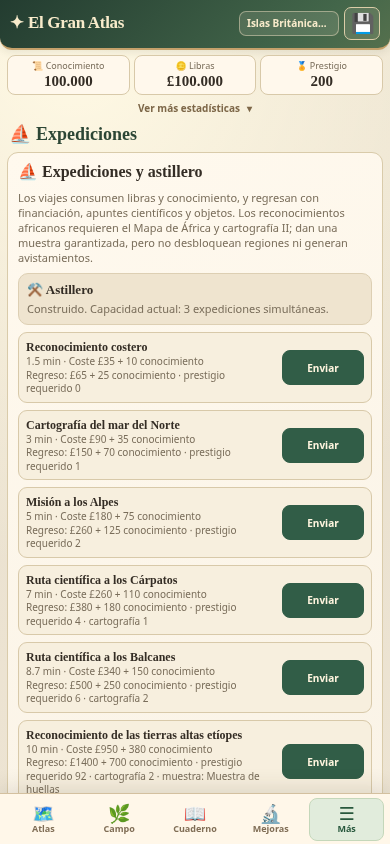
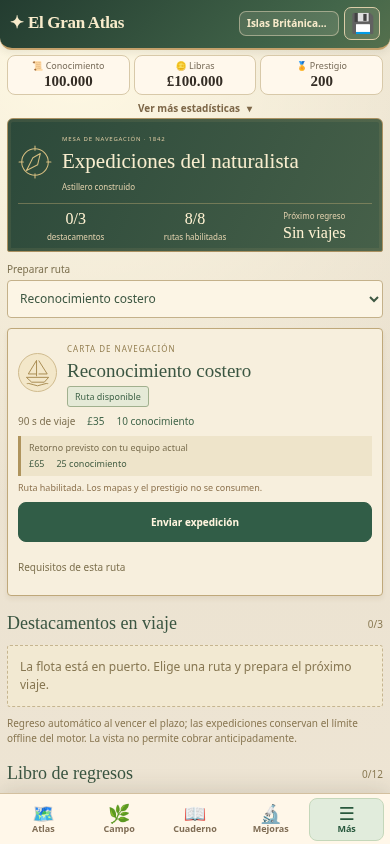
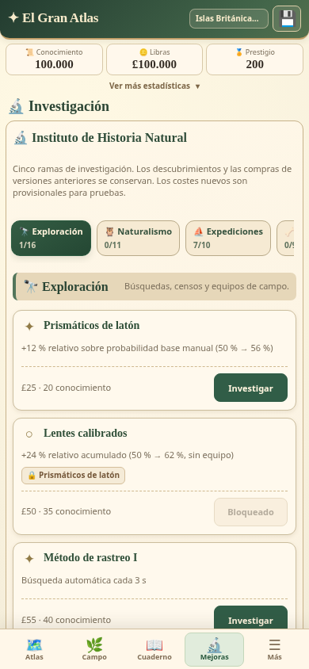
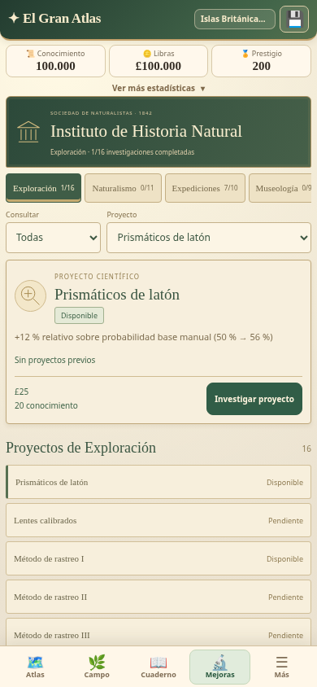

# El Gran Atlas v3.28.0 — Expediciones del naturalista

Renovación de **Expediciones e Investigaciones** como mesa de navegación e instituto científico de 1842. Se conservan **ocho rutas, cinco ramas, 52 investigaciones, 710 especies y 79 regiones**. No cambia el balance, el catálogo, las tablas de botín ni los otros módulos.

## Antes y después

| 3.27.0 | 3.28.0 |
| --- | --- |
|  |  |
|  |  |

[Comparación de Expediciones con motores reales](docs/expeditions-research-v3280/comparison-expeditions.png) · [Comparación de Investigaciones](docs/expeditions-research-v3280/comparison-research.png).

## Expediciones

Cabecera compacta con estado del astillero, destacamentos activos/capacidad real, rutas habilitadas y próximo regreso. El selector permite preparar cualquiera de las ocho rutas existentes sin desplegar un mapa mundial ni una lista extensa de tarjetas. La carta seleccionada muestra duración, libras, conocimiento, requisitos, previsión económica y muestra garantizada, cuando existe.

Los estados distinguen bloqueo, recursos insuficientes, flota completa y disponibilidad. Las condiciones salen de `VOYAGES` y los mismos valores usados por `sail()`. No se exige investigación africana adicional a las rutas cuyo contrato original solo pedía mapa, cartografía naval y prestigio. Los mapas y el prestigio se conservan como antes.

Las previsiones utilizan las funciones del motor y se identifican como valores con el equipo actual: las bonificaciones se calculan al regresar. El detalle de hallazgos posibles está separado de los materiales garantizados y de los recibidos. Brújula, collar, morral y gorro solo figuran activos si están equipados en su ranura; no se suman dos instrumentos incompatibles. Las tablas ponderadas permanecen intactas.

Los viajes activos muestran cuenta regresiva, fecha y previsión. Los nuevos registran una salida fiable y permiten una barra; los históricos sin inicio conservan solo su tiempo restante. El tick existente actualiza los elementos visibles, sin reconstruir la pantalla ni generar SVG.

[Viaje en curso](docs/expeditions-research-v3280/underway.png) · [Viaje histórico sin inicio inventado](docs/expeditions-research-v3280/historical-job.png) · [Regreso](docs/expeditions-research-v3280/lab-returned.png) · [Botín realmente recibido](docs/expeditions-research-v3280/return-with-loot.png) · [Regreso sin botín](docs/expeditions-research-v3280/lab-no-loot.png).

El libro conserva los últimos doce regresos nuevos. Recibe los importes y diferencias reales de inventario producidos por el motor, sin repetir sorteos. Se separan la muestra garantizada y los hallazgos aleatorios —incluidos fósiles, materiales históricos y ámbar—. Las partidas antiguas no reciben un historial fabricado. Tocar un material abre su sección del Inventario existente.

## Investigaciones

Las cinco ramas permanecen accesibles en una barra horizontal compacta. El progreso se calcula con las compras y nodos reales. Los filtros **Todas / Disponibles / Pendientes / Completadas** son temporales y conservan la rama.

La ficha seleccionada tiene prioridad: nombre, efecto original, nivel cuando corresponde, dependencias, materiales consumibles o conservados, costos reales y acción de compra. Las demás investigaciones ocupan una lista compacta. Las dependencias pueden abrir su proyecto; no compran ni conceden mejoras. Un repetible parcial no se confunde con un nivel máximo.

La navegación desde una ruta abre la investigación requerida en su rama, con compras normales. Volver al astillero conserva la ruta y su contexto. El resumen de bonificaciones se genera al desplegarlo y muestra encuentros efectivos, naturalistas, velocidad, conocimiento, grupos, censos, ponderaciones zoológicas y Museo desde sus funciones vigentes.

[Proyecto bloqueado](docs/expeditions-research-v3280/lab-research-locked.png) · [Investigación disponible](docs/expeditions-research-v3280/research-available.png) · [Dependencia múltiple pendiente](docs/expeditions-research-v3280/research-multiple-dependency.png) · [Repetible](docs/expeditions-research-v3280/lab-research-repeat.png) · [Bonificaciones efectivas](docs/expeditions-research-v3280/effective-bonuses.png).

## Correcciones funcionales autorizadas

**Finalización anticipada:** `finishVoyage()` ahora rechaza viajes antes de `endAt`, fechas no válidas y solicitudes sobre trabajos ya resueltos. No gasta ni paga nada al rechazarlas. Se elimina «Finalizar ahora» de la presentación de producción. `processVoyages()` conserva el regreso automático y el pago único al vencer el plazo; no se introduce una reclamación manual.

**Dependencias múltiples:** `buyNode()` reutiliza `canBuy()` antes de gastar y aplicar efectos. Así respeta `reqAll` en Patrullas de observación, Censo automatizado, Laboratorio de fósiles y Rastreo de poblaciones singulares. Se conservan precios, materiales, consumos, límites, repetibles y compras anteriores.

El código previo completo permanece idéntico fuera de los bloques nuevos identificados. Los cambios económicos se limitan a estas validaciones; 64 comparaciones con el motor publicado de 3.27.0 verifican recursos, botines y llamadas aleatorias idénticos en las ocho rutas, cuatro niveles paleontológicos y dos configuraciones de equipo. [Arquitectura y contratos](docs/expeditions-research-v3280/architecture.md) · [Huellas y alcance](docs/expeditions-research-v3280/scope.json).

## Pruebas y compatibilidad

**383/383 pruebas aprobadas**, incluidas **31 específicas**. Cubren requisitos, costos, capacidades, duraciones, bonificaciones, expiración online/offline, rechazo anticipado, premios exactos, ausencia de duplicados, `req`, `reqAll`, materiales consumibles/no consumibles, repetibles, máximos, filtros, historial y navegación. Los fixtures históricos mantienen sus valores. [Resultados](docs/expeditions-research-v3280/test-report.json) · [Salida completa](docs/expeditions-research-v3280/tests.txt).

Las seis partidas históricas de referencia conservan sus campos originales y pasan por las dos pantallas, exportación/importación y restauración. Se mantienen `gran_atlas_v05`, IDs, compras, inventario, Museo, naturalistas, flota y viajes activos. Se verifican por separado la persistencia de las salidas nuevas y el desglose real de regresos. Las únicas adiciones persistentes autorizadas son `voyages[].startedAt`, solo para salidas nuevas, y `voyageHistory`, con máximo de doce resultados.

La prueba PWA instala primero el worker 3.27.0 con una partida que incluye un viaje antiguo activo sin inicio registrado. Exige aceptación explícita, comprueba copia exacta, espera el control del worker 3.28.0 y verifica todos los campos sin cambios y reapertura offline. Continúan las entradas de recuperación anteriores y los plugins nativos. [Resultado PWA](docs/expeditions-research-v3280/pwa-update-report.json).

Pruebas responsive en **320×640, 360×740, 390×844 y 412×915**: las acciones principales quedan visibles, sin desbordamiento horizontal; las cinco ramas, ocho rutas, detalles, materiales, navegación y contadores funcionan. Campo, Atlas, Cuaderno, Bestiario y Museo también abren correctamente. Los módulos y el laboratorio reabren sin conexión. [Informe del navegador](docs/expeditions-research-v3280/browser-report.json).

Son pruebas de **Chromium emulado con interacción táctil**, no de un teléfono Android físico. La prueba nativa usa los contratos de los plugins; el APK compilado se verifica separadamente.

## Laboratorio y rendimiento

[Laboratorio independiente](https://pruizbohle.github.io/gran-atlas-naturaleza/laboratorio-expediciones-investigaciones-v3280.html) con dieciséis escenarios, motores reales 3.27.0/3.28.0, marcos de origen opaco y memoria temporal. No lee ni escribe partidas personales. La versión anterior conserva su comportamiento real únicamente dentro de ese aislamiento.

La medición usa CPU ×4, una misma partida y secuencia ABBA repetida dos veces. Se registran mejoras y empeoramientos: no se promete una aceleración universal. [Tabla de resultados y limitaciones](docs/expeditions-research-v3280/performance.md) · [Datos por ensayo](docs/expeditions-research-v3280/performance-report.json) · [Reproducir](docs/expeditions-research-v3280/reproduce.md).

## Publicación

Preparado para **3.28.0 / Android 32800**, conservando `com.elgranatlas.naturaleza.beta314` y el actualizador seguro con respaldo. Nueva entrada: [actualizar-v3280.html](https://pruizbohle.github.io/gran-atlas-naturaleza/actualizar-v3280.html).

**Antes de publicar:** validación local completada; todavía no se declara éxito de Actions ni disponibilidad del APK 3.28.0. El resultado final se documentará tras verificar ambos workflows, descargar el paquete y comparar su firma con 3.27.0.

Pendiente no bloqueante: pruebas físicas de instalación, ergonomía y rendimiento Android. La firma debug puede cambiar entre compilaciones; no se garantiza una actualización directa sin comparar el certificado. Exportar el respaldo antes de cambiar de instalación.

Esta entrega cierra la renovación de presentación de los módulos actuales. La serie **GM — Globo Mundial** queda como siguiente etapa; no se inicia en esta versión.
