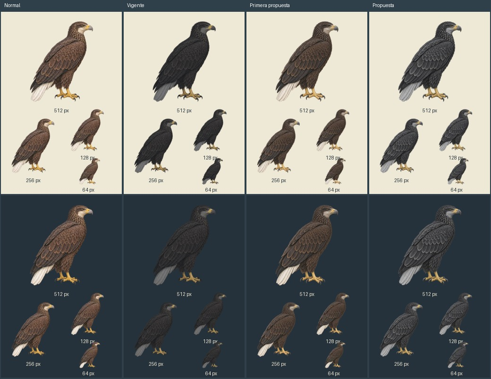
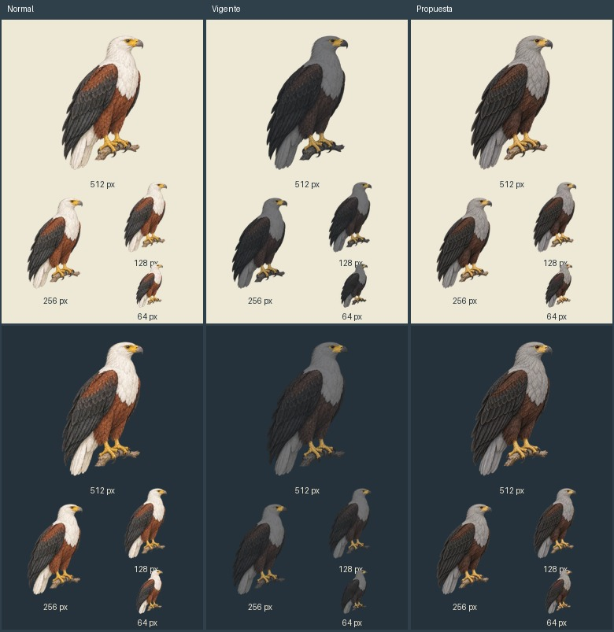
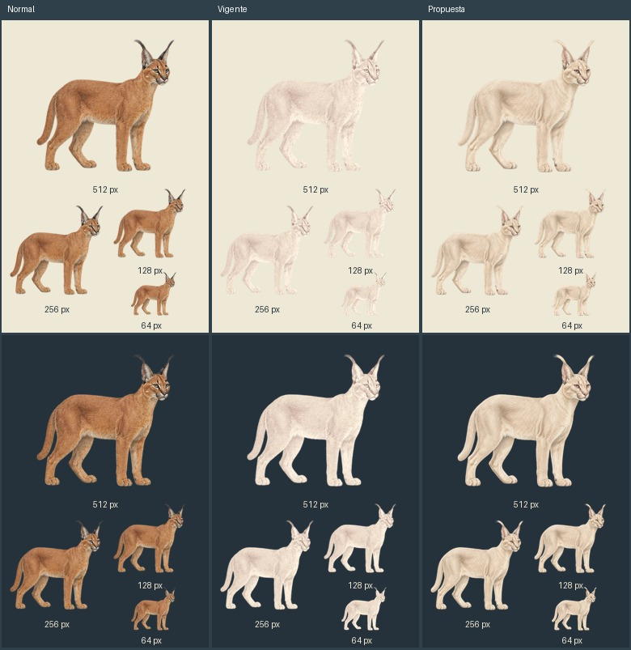
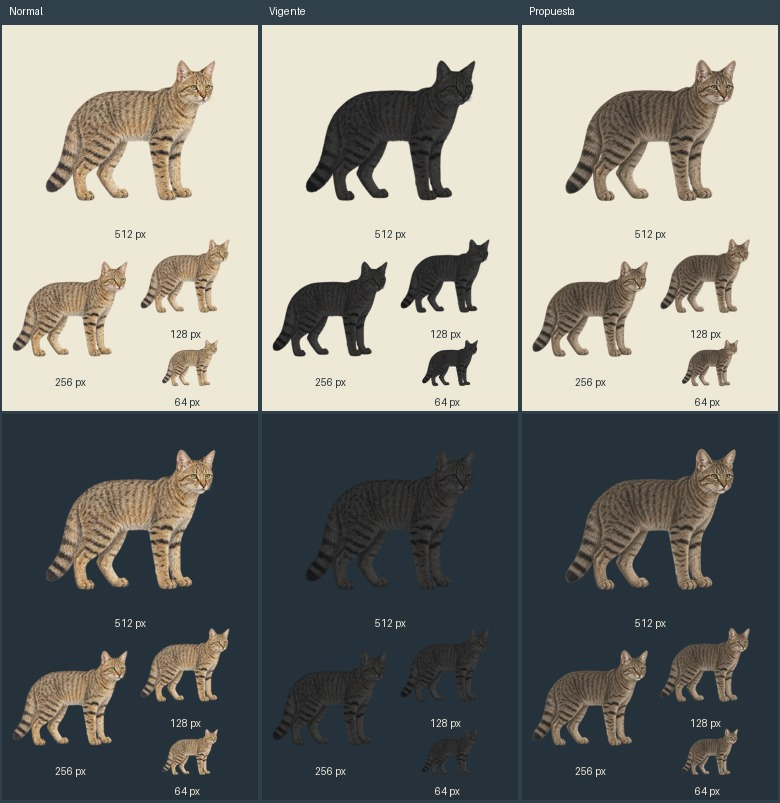
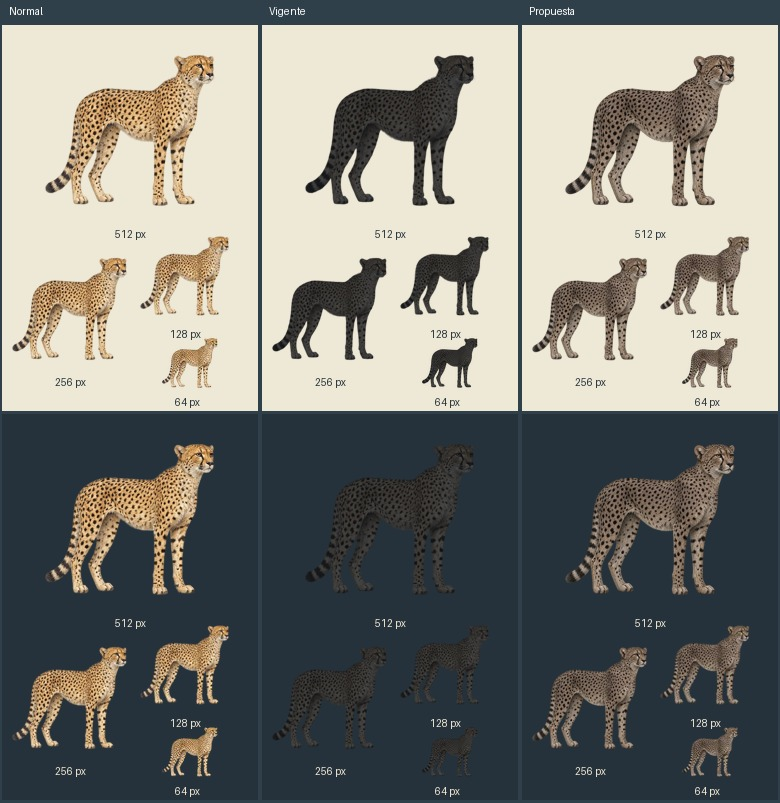
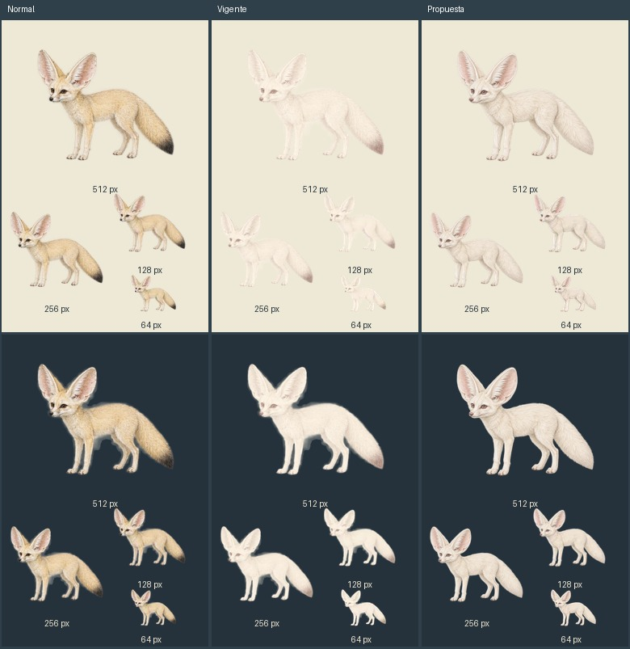
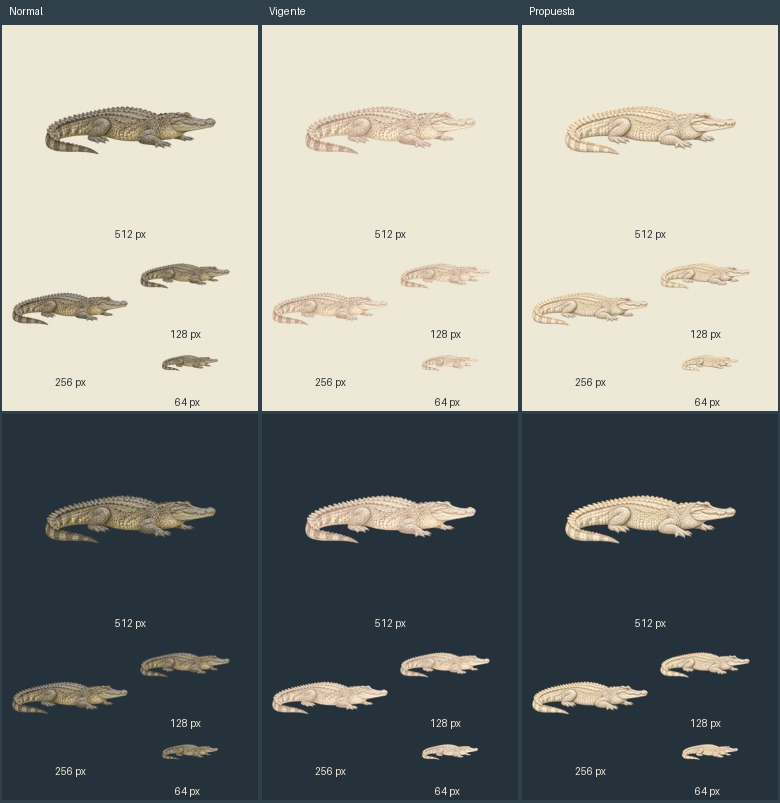
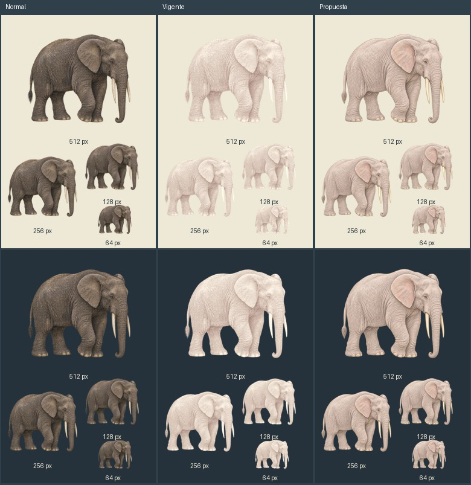
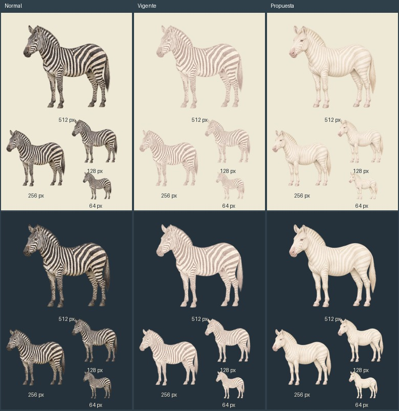
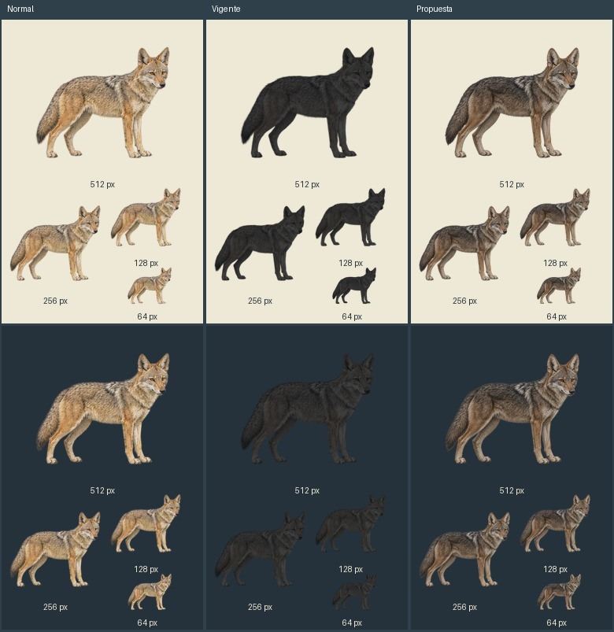

# ART-08A · Comparativas de diez animales

Las comparativas muestran la lámina normal, la variante previa y la propuesta sobre crema y carbón, con derivados WebP de 64, 128, 256 y 512 px. Las decisiones registran el color ocular y el alcance de la evidencia biológica.

## Pigargo de Madagascar · melánica

**Aprobada** · Melanismo interpretativo · Interpretativa. El repintado pizarra conserva la cola gris y los tarsos ocres. Las hileras de plumas mantienen detalle sobre carbón.

**Iris.** Pardo amarillento. El tono habitual se mantiene legible al separar cera, pico, ojo y nuca.

Primera propuesta descartada por aproximarse demasiado al tono pardo y la cola blanca del ejemplar normal. [Primera propuesta](comparativas/A/af_fosa_ave--melanico--rechazo.jpg)

[Ficha de Madagascar National Parks](https://protectedareas.mg/content/documents/0cd9156e-e528-4293-b8da-d00aa5f5af4f/dc17b8fd22bd4c08ad8fcddd92d3ff17.pdf)

## Águila pescadora · melánica

**Aprobada** · Melanismo de manto interpretativo · Interpretativa. Cabeza, babero y cola gris humo destacan frente a pecho oscuro y alas estratificadas. El plumaje todavía conserva trazos castaños en los hombros.

**Iris.** Pardo oscuro. Se mantiene la gama natural al definir la pupila y la cera.

[The Peregrine Fund](https://peregrinefund.org/explore-raptors-species/eagles/african-fish-eagle)

## Caracal · albina

**Aprobada** · Albinismo interpretativo · Interpretativa. Los pinceles largos ganan contorno fino. El manto marfil conserva sombras en nariz, pecho y patas delanteras.

**Iris.** Rosado pardo tenue. Iris y pupila se separan del relieve del hocico.

[IUCN Cat Specialist Group](https://www.catsg.org/living-species-caracal)

## Gato montés africano · melánica

**Aprobada** · Melanismo interpretativo · Interpretativa. El pelaje gris pardo oscuro conserva barras y anillos. Se distinguen cuello, cara y patas superpuestas sobre carbón.

**Iris.** Ámbar oliváceo. Se recupera el iris mediante el modelado de párpados y planos del cuello.

[IUCN Cat Specialist Group](https://www.catsg.org/living-species-africanwildcat)

## Guepardo · melánica

**Aprobada** · Melanismo interpretativo · Interpretativa. Sobre carbón se leen cabeza, hombros y extremidades largas. Conserva puntos pequeños, abdomen recogido y cola anillada.

**Iris.** Ámbar pardo. Se mantiene el iris habitual y se devuelve relieve al párpado dentro de la línea lagrimal.

[IUCN Cat Specialist Group](https://www.catsg.org/living-species-cheetah)

## Fénec · albina

**Aprobada** · Albinismo interpretativo · Interpretativa. La piel interior de la oreja queda bien separada del borde con pelo. Vientre, patas y hocico se leen con sombras grises.

**Iris.** Pardo rosado. La pupila se mantiene pequeña y oscura y la nariz se aclara sin teñir el pelaje.

[Smithsonian’s National Zoo](https://nationalzoo.si.edu/animals/fennec-fox)

## Cocodrilo del Nilo · albina

**Aprobada** · Hipopigmentación de aspecto albino · Interpretativa. Se distinguen las escamas dorsales, el vientre y el perfil mandibular. La cola conserva la curvatura y los dedos se leen sobre carbón.

**Iris.** Ámbar rosado pálido. Se aclara la gama del iris y se preserva la pupila vertical del cocodrilo.

[Animal Diversity Web](https://animaldiversity.org/accounts/Crocodylus_niloticus/)

## Elefante de bosque · albina

**Aprobada** · Albinismo interpretativo · Interpretativa. Colmillos rectos, uñas, pliegues de la trompa y orejas ovaladas conservan detalle. Los colmillos color marfil se separan de la piel.

**Iris.** Pardo apagado con entorno malva. El ojo pequeño se conserva en una gama sobria. El rosado se concentra en tejidos cercanos.

[WWF](https://www.worldwildlife.org/species/african-forest-elephant)

## Cebra de llanura · albina

**Aprobada** · Hipopigmentación de aspecto albino · Interpretativa. Las franjas pasan a crema cerca de la crin y las cuartillas. El relieve local separa hocico, casco y patas.

**Iris.** Pardo rosado atenuado. Se recupera el iris con un tono tenue. Las franjas residuales indican una interpretación gráfica de hipopigmentación.

[San Diego Zoo Wildlife Alliance](https://ielc.libguides.com/c.php?g=692911&p=4908695)

## Chacal dorado africano · melánica

**Aprobada** · Melanismo interpretativo · Interpretativa. El lomo oscuro conserva relieve en hombros, patas y base de la cola. El sombreado local mantiene el perfil de orejas y hocico.

**Iris.** Ámbar pardo. El ojo conserva una gama cálida natural bajo el reborde supraocular.

[IUCN Canid Specialist Group](https://doi.org/10.2305%2FIUCN.UK.2019-1.RLTS.T118264888A118265889.en)
