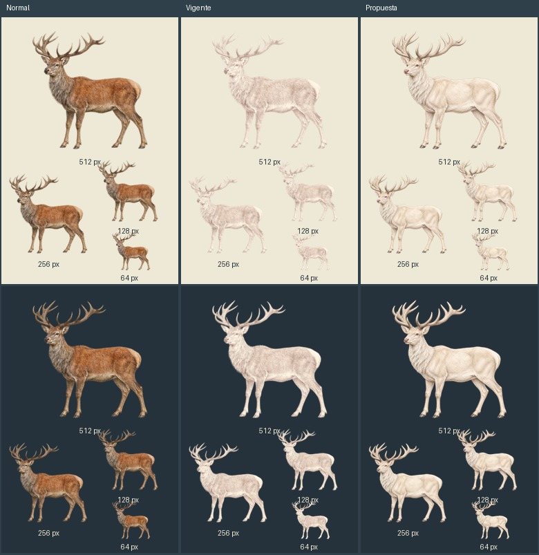
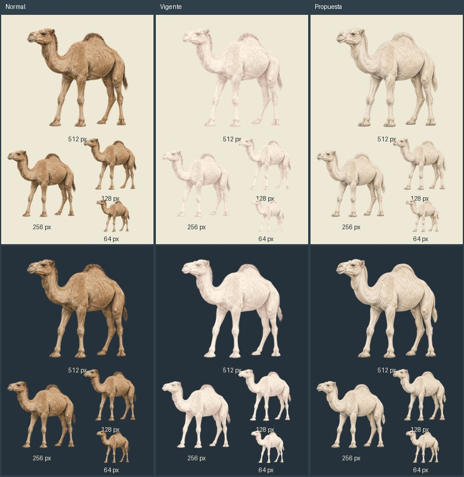
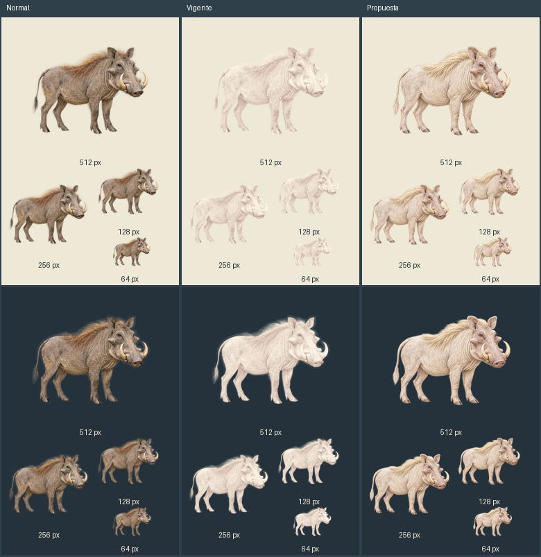
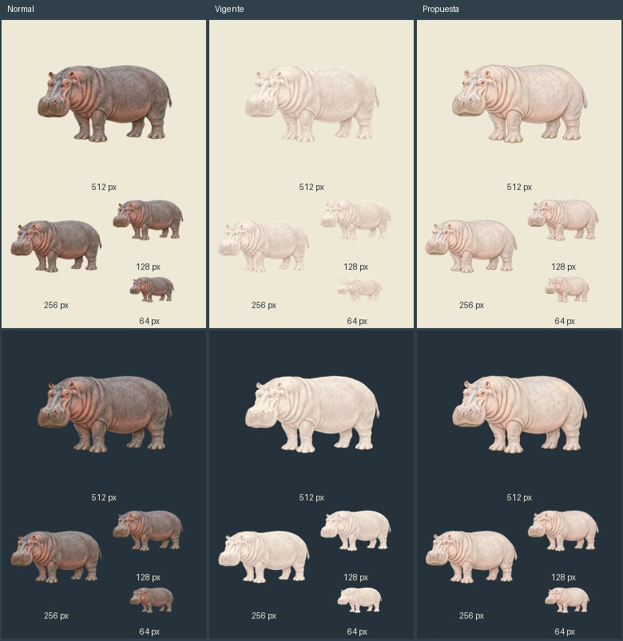
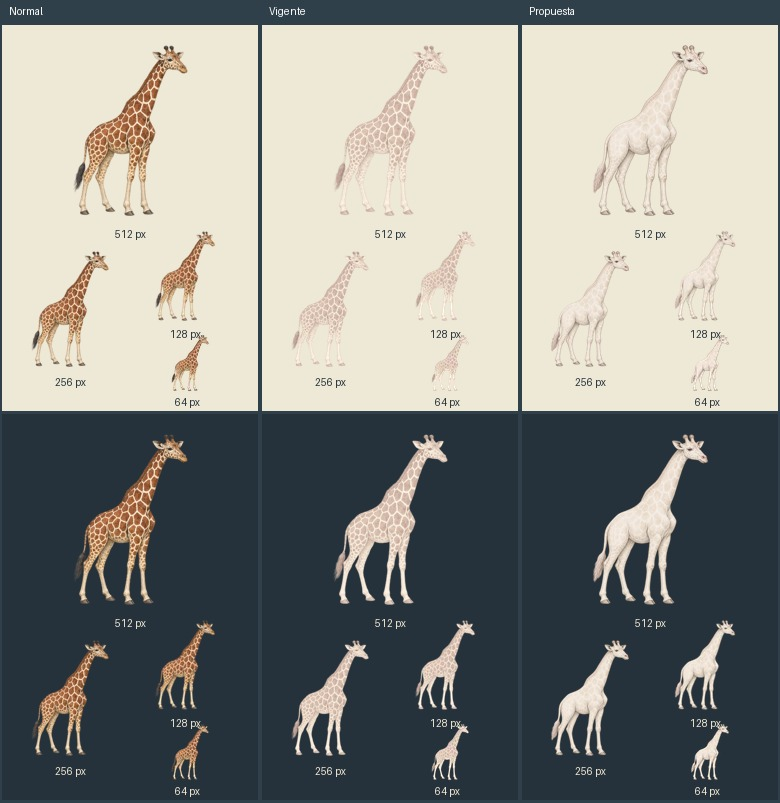
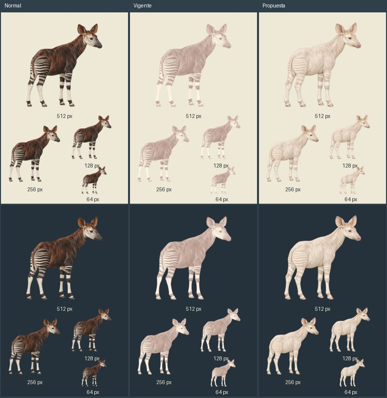
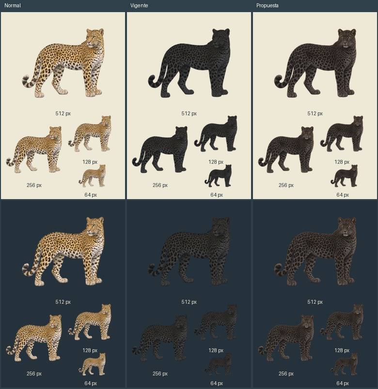
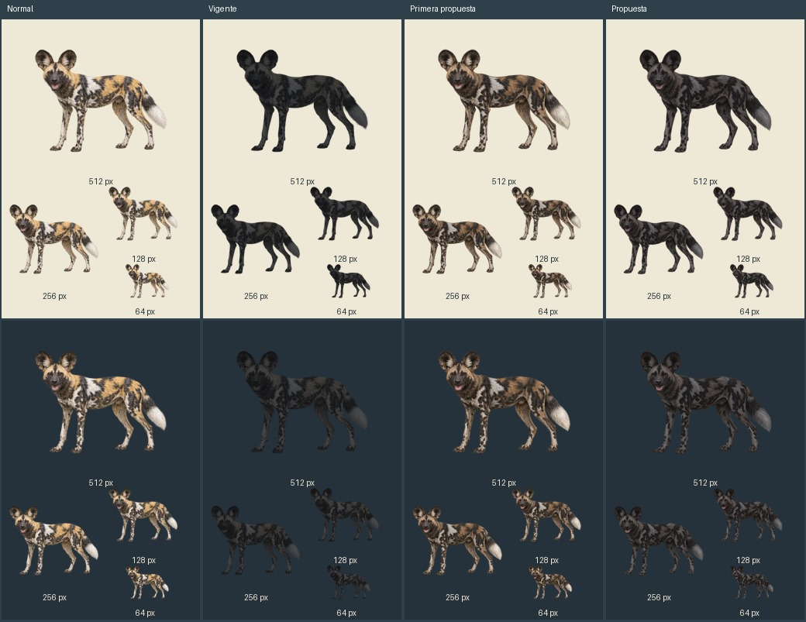
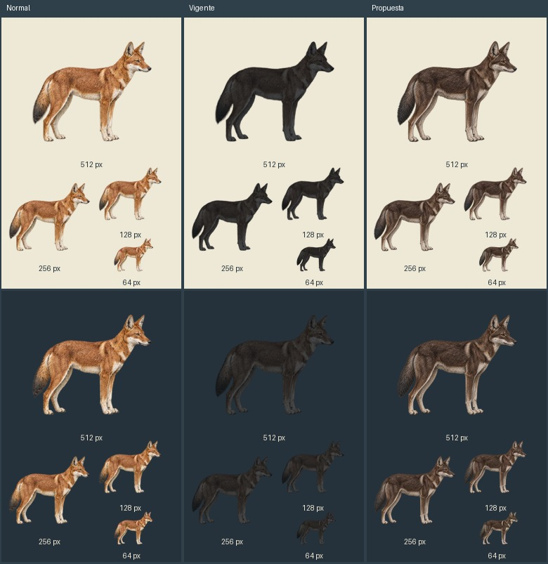
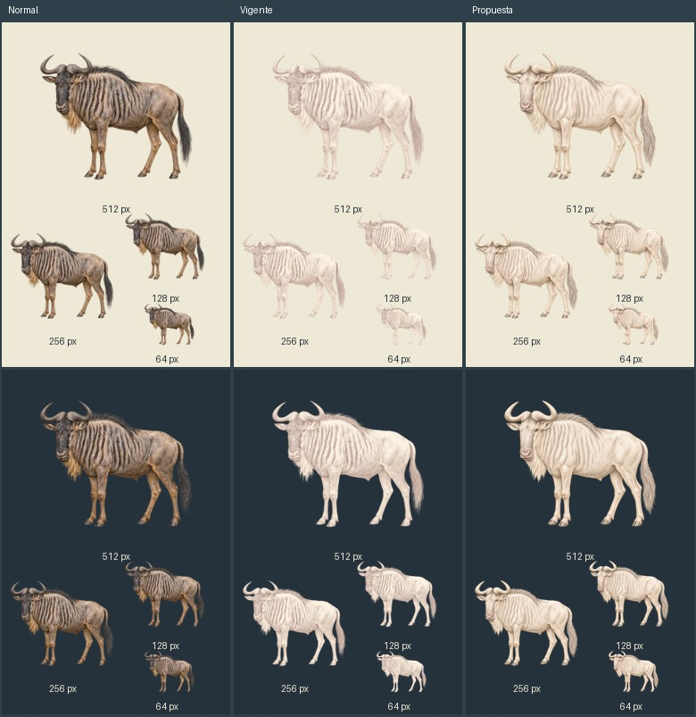

# ART-08B · Comparativas de diez animales

Las comparativas muestran la lámina normal, la variante previa y la propuesta sobre crema y carbón, con derivados WebP de 64, 128, 256 y 512 px. Las decisiones registran el color ocular y el alcance de la evidencia biológica.

## Ciervo de Berbería · albina

**Aprobada** · Albinismo interpretativo · Interpretativa. Sobre papel se distinguen las puntas de la cuerna y el pelo largo del cuello. Las patas mantienen articulaciones y pezuñas separadas.

**Iris.** Rosado pardo tenue. Se recuperan el ojo y la transición entre párpado, hocico y gorguera.

[Guía de mamíferos de África](https://arcadia.sba.uniroma3.it/bitstream/2307/2054/1/A%20field%20Guide%20to%20the%20Mammals%20of%20Africa.pdf)

## Dromedario · albina

**Aprobada** · Hipopigmentación de aspecto albino · Interpretativa. La joroba única, el cuello, el labio hendido y las almohadillas de dos dedos ganan definición en crema.

**Iris.** Pardo grisáceo claro. El ojo conserva una pupila oscura. El párpado y el labio recuperan su sombra local.

[Estudio anatómico de cabeza y hocico](https://anatomypubs.onlinelibrary.wiley.com/doi/10.1002/ar.22865)

## Facóquero · albina

**Aprobada** · Albinismo interpretativo · Interpretativa. La crin, los colmillos y las verrugas faciales conservan volumen. La piel rosada del morro se distingue de las cerdas claras.

**Iris.** Pardo rosado. El tono y la sombra del párpado se separan de las verrugas y del colmillo.

[Animal Diversity Web](https://animaldiversity.org/accounts/Phacochoerus_africanus/)

## Hipopótamo · albina

**Aprobada** · Albinismo interpretativo · Interpretativa. El volumen del labio y los pliegues del cuello se distinguen sobre crema. La piel mantiene motas suaves y sombras en las cuatro patas.

**Iris.** Pardo rosado claro. El ojo alto recupera contorno y el tono se limita al iris y al tejido próximo.

[San Diego Zoo Wildlife Alliance](https://animals.sandiegozoo.org/animals/hippo)

## Jirafa · albina

**Aprobada** · Hipopigmentación de aspecto albino · Leucismo conocido en jirafas · morfo del Atlas interpretativo. Las manchas quedan insinuadas en marfil. La cara, los osiconos y las patas distales mantienen relieve sobre crema.

**Iris.** Gris rosado tenue. Se aclara la gama ocular. La lámina representa un ejemplar hipotético y el ojo de las jirafas leucísticas puede conservar pigmento.

[San Diego Zoo Wildlife Alliance](https://ielc.libguides.com/c.php?g=692924&p=4908612)

## Okapi · albina

**Aprobada** · Hipopigmentación de aspecto albino · Leucismo documentado en la especie · albinismo interpretativo. Las bandas de grupa y patas se atenúan. Las orejas, el ojo y las pezuñas recuperan volumen sobre crema.

**Iris.** Pardo rosado suave. El iris tenue es interpretativo. La guía EAZA describe leucismo, una condición pigmentaria diferente.

[Guía EAZA de okapi y leucismo](https://media.eaza.net/uploads/2024_EAZA_Okapi_Best_Practice_Guidelines_APPROVED_c901c668ed.pdf)

## Leopardo africano · melánica

**Aprobada** · Melanismo con rosetas visibles · Documentada en leopardo africano · lámina interpretativa del ejemplar. Las rosetas y el patrón de la cola siguen visibles sobre un manto oscuro. La mandíbula y el cuello se distinguen en miniatura.

**Iris.** Ámbar pardo. Se conserva el iris natural y se modelan el ojo y el morro con reflejos locales.

[Registro fotográfico de melanismo en Kenia](https://adminzoonooz.sandiegozoo.org/story-hub/2019/02/11/rare-black-leopards-appear-on-san-diego-zoo-global-remote-cameras)

## Licaón · melánica

**Aprobada** · Melanismo interpretativo · Interpretativa. La segunda propuesta separa las orejas redondas, los dedos y los parches del cuello y las patas sobre carbón. La punta caudal conserva un gris más claro.

**Iris.** Pardo oscuro. Se conserva el iris natural y se mejora el contraste local con el hocico.

Primera propuesta descartada por sus parches dorados y blancos, demasiado cercanos a la lámina normal. [Primera propuesta](comparativas/B/af_licaon--melanico--rechazo.jpg)

[IUCN Canid Specialist Group](https://canids.org/canids/african-wild-dog/)

## Lobo etíope · melánica

**Aprobada** · Melanismo interpretativo · Interpretativa. Se distinguen máscara, morro largo, orejas y patas altas. El manto pardo oscuro conserva una gama intermedia sobre el vientre y el cuello.

**Iris.** Ámbar oscuro. El ojo conserva su gama cálida. Se recupera el detalle de la pupila y de la nariz mediante sombras y reflejos pequeños.

[IUCN Canid Specialist Group](https://canids.org/canids/ethiopian-wolf/)

## Ñu azul · albina

**Aprobada** · Hipopigmentación de aspecto albino · Interpretativa. Cuernos bajos y barba conservan contorno. Las bandas del cuello quedan suaves y mantienen relieve entre el pecho y el hombro.

**Iris.** Pardo rosado suave. Se aclara el iris y se reserva el rosado para el ollar, labios y entorno ocular.

[SANParks](https://www.sanparks.org/conservation/parks/marakele-national-park/primary-consumers-herbivores/blue-wildebeest)
