# Comparativas ART-01 a 256 px

El laboratorio permite alternar las cuatro resoluciones y los fondos claro y oscuro.

## Gorila de montaña · Albino

| Lámina normal | Variante anterior | Variante corregida |
|---|---|---|
| 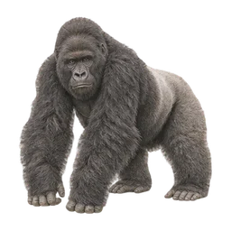 | 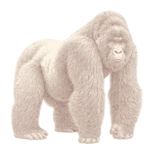 |  |

Marfil en el manto, sombras frías en hombros y piel desnuda diferenciada en párpados, rostro y nudillos. El caso documentado de Copito de Nieve corresponde a otro taxón de gorila.

## Gorila de montaña · Melánico

| Lámina normal | Variante anterior | Variante corregida |
|---|---|---|
|  | 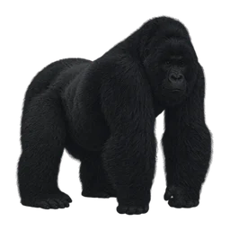 | 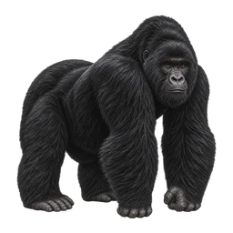 |

El pelaje casi negro conserva mechones en hombros y antebrazos. Los reflejos locales recuperan la profundidad de las cejas, la nariz y las manos.

## Tigre · Albino

| Lámina normal | Variante anterior | Variante corregida |
|---|---|---|
| 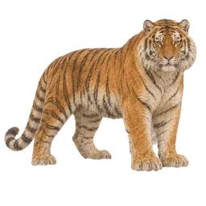 | 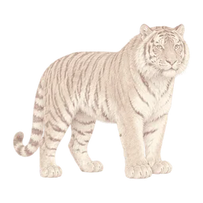 | 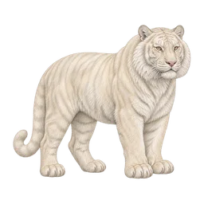 |

Hocico claro, iris poco pigmentado y mejillas anchas. Las bandas tenues se tratan como valores del pelaje y ayudan a reconocer la especie. El tigre blanco documentado conserva un patrón pigmentario distinto.

## Tigre · Melánico

| Lámina normal | Variante anterior | Variante corregida |
|---|---|---|
|  | 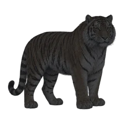 | 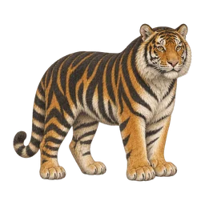 |

Las rayas se ensanchan y confluyen sobre lomo y flancos. Se mantienen ventanas ocres, la cara y el patrón de las extremidades.

## Jaguar · Albino

| Lámina normal | Variante anterior | Variante corregida |
|---|---|---|
| 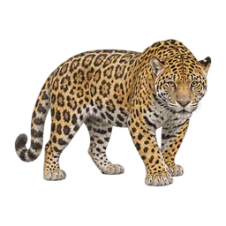 | 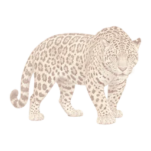 | 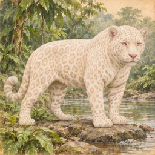 |

El pelaje marfil deja leer la mandíbula y las patas robustas. Se ajustaron la pigmentación del iris, la trufa y el interior de las orejas. Las rosetas oscuras de la variante anterior ceden protagonismo a la anatomía.

## Jaguar · Melánico

| Lámina normal | Variante anterior | Variante corregida |
|---|---|---|
|  | 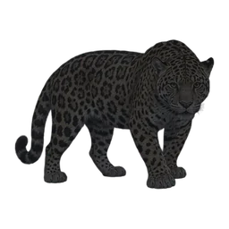 | 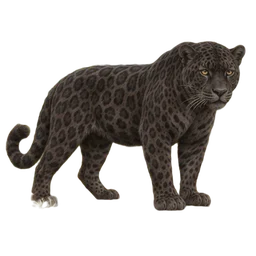 |

Sobre el manto carbón quedan rosetas oscuras discretas en luz lateral. El ojo, las almohadillas de las vibrisas y las articulaciones conservan volumen.

## Zorro rojo · Albino

| Lámina normal | Variante anterior | Variante corregida |
|---|---|---|
| 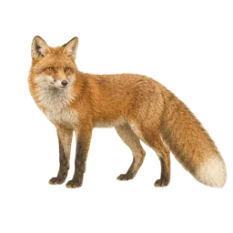 | 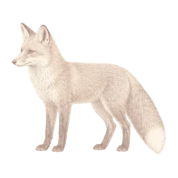 |  |

La piel de oreja, hocico y párpado se separa del pelo claro. Se retuvieron la línea fina del hocico y la textura de la cola.

## Zorro rojo · Melánico

| Lámina normal | Variante anterior | Variante corregida |
|---|---|---|
|  | 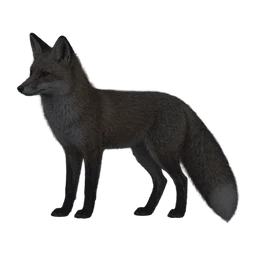 | 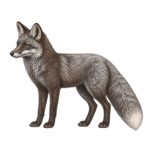 |

Manto pardo negruzco con pelos de guarda plateados y punta clara de la cola. La luz local vuelve a definir hocico, ojos y extremidades.

## Hipopótamo · Melánico

| Lámina normal | Variante anterior | Variante corregida |
|---|---|---|
| 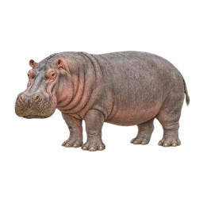 | 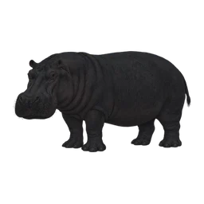 | 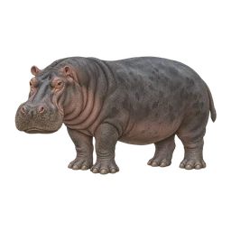 |

Piel dorsal de pizarra, reflejos pardos en los pliegues y transición localizada en orejas y labios. Los dedos, la nuca y la papada mantienen relieve en fondo oscuro.

## Pangolín gigante · Melánico

| Lámina normal | Variante anterior | Variante corregida |
|---|---|---|
| 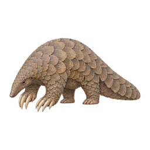 | 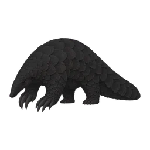 |  |

Las escamas de queratina en marrón carbón conservan bordes y estrías. El ojo, la cara y las garras siguen separados de la armadura.

## Nutria europea · Melánico

| Lámina normal | Variante anterior | Variante corregida |
|---|---|---|
| 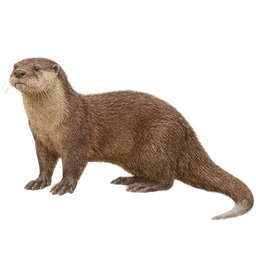 | 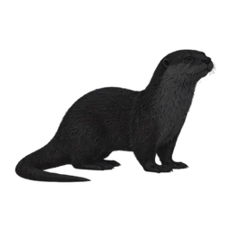 | 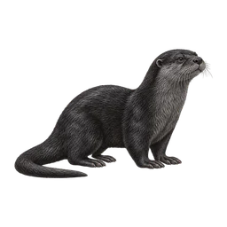 |

Se distingue el hocico por la trufa y las vibrisas, la garganta por el valor intermedio y las patas delanteras por sus contornos. La cola sigue legible en fondo oscuro.

Las tres propuestas descartadas y sus segundas versiones se muestran en la mesa de revisión. [Ver mesa de revisión](mesa-de-revision.jpg)

Los recortes de detalle a tamaño nativo permiten cotejar las trufas, iris, vibrisas y escamas sobre ambos fondos. [Detalles a 512 px](detalles-anatomicos.jpg)
