# LEG-01 · Galería visual

Comparación de las láminas normales, pigmentarias disponibles, legendarias anteriores y propuestas. Cada columna usa WebP de 64, 128, 256 y 512 px sobre fondo crema y carbón.

## Silverback · Mejorado

La silueta erguida y el parche plateado de la versión anterior quedaban cerca de la normal.

La pose de reposo presenta la cresta, los nudillos y la silla plateada del lomo.

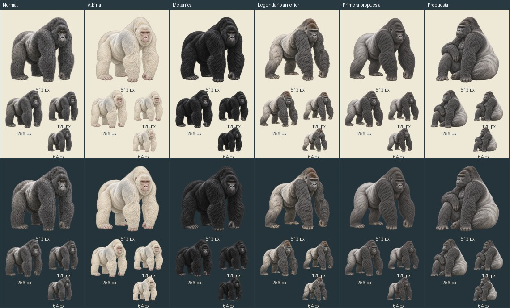

Primera propuesta descartada porque repetía el apoyo y el ángulo de la lámina anterior con menos contraste. [Primera propuesta](comparativas/af_gorila_montana--silverback--propuesta-1.jpg)

## Fenrir · Mejorado

El lobo frontal y el normal compartían gran parte del manto y la postura era la única diferencia clara.

La postura de aullido y la gorguera invernal plateada se reconocen en miniatura.

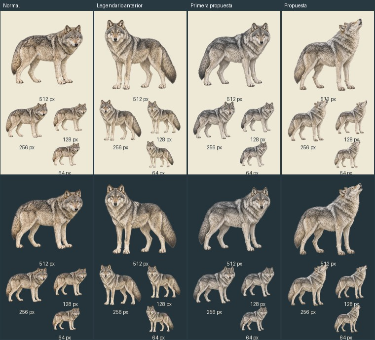

Primera propuesta descartada por volver al perfil de la lámina normal y mantener la cabeza neutra. [Primera propuesta](comparativas/lobo_gris--fenrir--propuesta-1.jpg)

[National Park Service · ecología del lobo](https://www.nps.gov/yell/learn/nature/wolf.htm)

## Atlas · Mejorado

La trompa caía entre planos superpuestos y daba la impresión de apoyos adicionales.

Se distinguen cuatro patas con cuatro pies. La trompa se curva hacia delante y los dos colmillos conservan longitudes distintas.

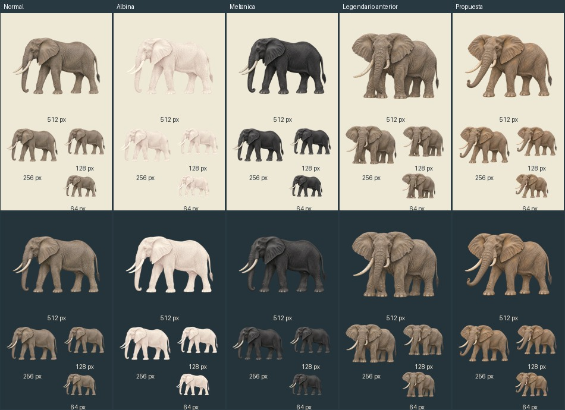

[WWF · anatomía del elefante africano](https://www.worldwildlife.org/resources/facts/whats-the-difference-between-asian-and-african-elephants-and-9-other-elephant-facts/)

## Ascua · Mejorado

La cola beige del ejemplar anterior perdía el rasgo que da origen al nombre.

La cola envolvente concentra cobre y bermellón. El babero marfil, las patas oscuras y la punta clara se mantienen.

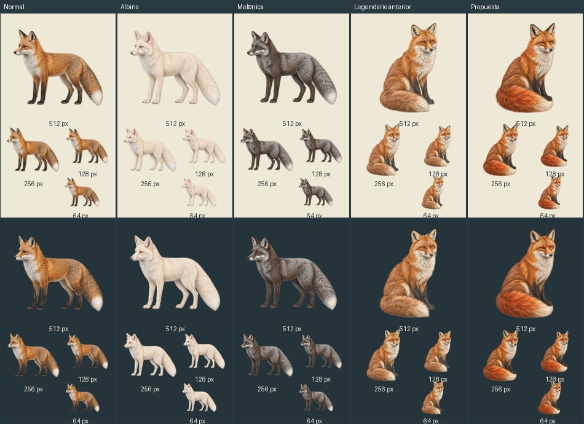

[Mammalian Species · zorro rojo](https://www.science.smith.edu/departments/biology/VHAYSSEN/msi/pdf/i0076-3519-537-01-0001.pdf)

## Espiral · Nuevo

Gran kudú del catálogo. Ya pertenecía a las categorías Épico y Excepcional.

Cuernos de dos vueltas visibles, cabeza de frente y barba con un borde blanco sobre flancos rayados.

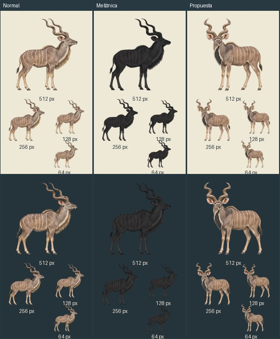

[Toronto Zoo · gran kudú](https://www.torontozoo.com/animals/Greater%20kudu)

## Bastión · Nuevo

Pangolín gigante del catálogo. Ya pertenecía a las categorías Épico y Excepcional.

El perfil cerrado en defensa concentra las escamas cobrizas y conserva la forma ancha de la base de la cola.

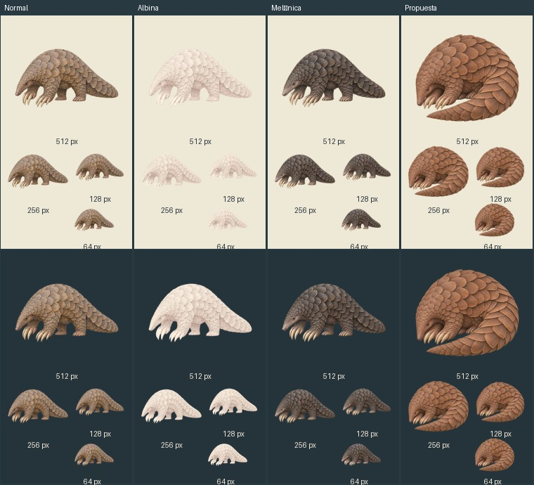

[IUCN SSC Pangolin Specialist Group](https://pangolinsg.org/portfolio/giant-pangolin/)

## Ciénaga · Nuevo

Picozapato del catálogo. Ya pertenecía a la categoría Épico.

Pico en gancho inclinado, cresta desflecada y patas largas abiertas sobre una silueta agazapada.

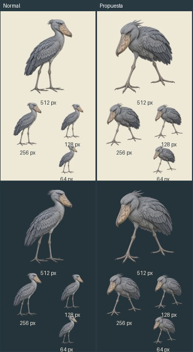

## Alisio · Nuevo

Frailecillo atlántico del catálogo en plumaje nupcial.

Alas elevadas al despegar, pies palmeados tras el cuerpo y surcos de color bien delimitados en el pico.

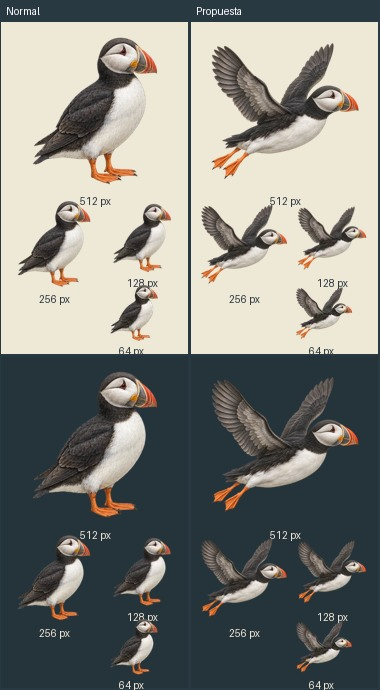

[Cornell Lab · frailecillo atlántico](https://www.allaboutbirds.org/guide/Atlantic_Puffin/id)

## Filigrana · Nuevo

Ajolote mexicano del catálogo. La guía distingue el tipo silvestre oscuro de las formas pigmentarias en cautiverio.

Vista oblicua en nado, branquias color ciruela y punteado fino sobre oliváceo.

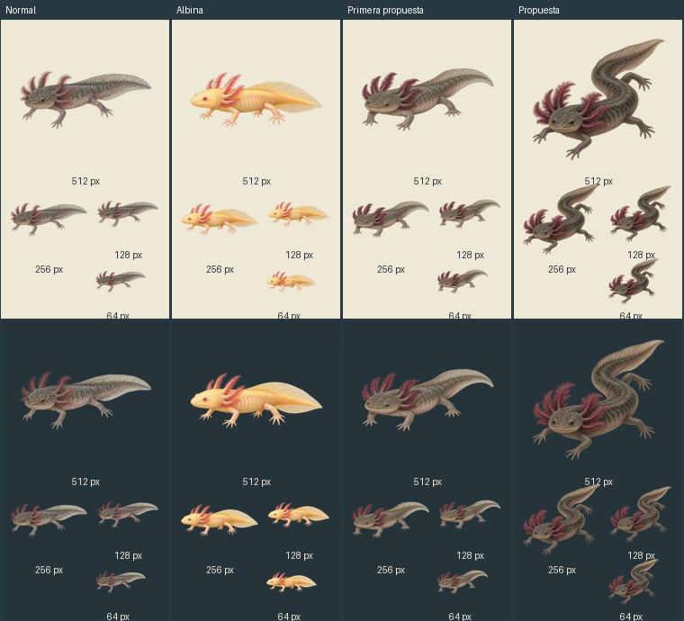

Primera propuesta descartada por repetir casi el mismo ángulo de la lámina normal. [Primera propuesta](comparativas/na_esp_ambystoma_mexicanum--filigrana--propuesta-1.jpg)

[San Diego Zoo Wildlife Alliance · ajolote](https://ielc.libguides.com/sdzg/factsheets/axolotl)

## Terracota · Nuevo

Canguro rojo del catálogo en postura de salto.

El cuerpo casi horizontal, la cola en contrapeso y las patas en extensión construyen una silueta diferente a la postura en reposo.

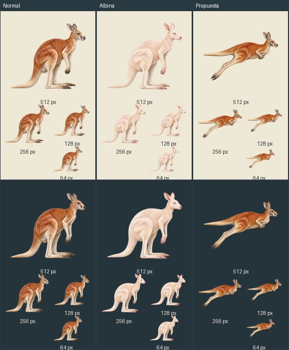

[Australian Museum · canguro rojo](https://australian.museum/learn/animals/mammals/red-kangaroo/)

## Orla · Nuevo

Ballena jorobada del catálogo. Giro de tres cuartos para exponer las marcas ventrales.

Perfil en ascenso con aletas pectorales largas, nódulos de los bordes y manchas en la cara inferior de la cola.

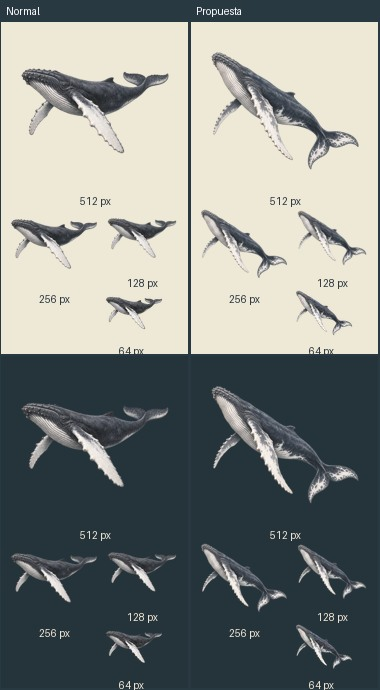

[NOAA Fisheries · ballena jorobada](https://www.fisheries.noaa.gov/species/humpback-whale)

## Marea · Nuevo

Pulpo gigante del Pacífico del catálogo. Abre el abanico de brazos y expone las ventosas.

Manto alto, ocho brazos trazables y contraste entre las ventosas claras y la piel coral.

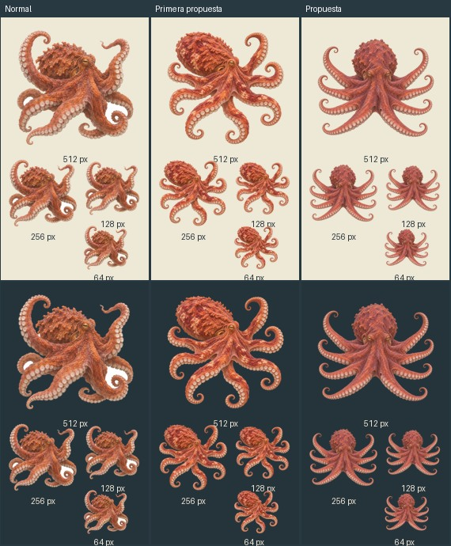

Primera propuesta descartada porque solo siete brazos podían distinguirse en la lámina. [Primera propuesta](comparativas/mar_esp_enteroctopus_dofleini--marea--propuesta-1.jpg)

[Monterey Bay Aquarium · pulpo gigante del Pacífico](https://www.montereybayaquarium.org/animals-the-ocean/animals-a-to-z/giant-pacific-octopus)
