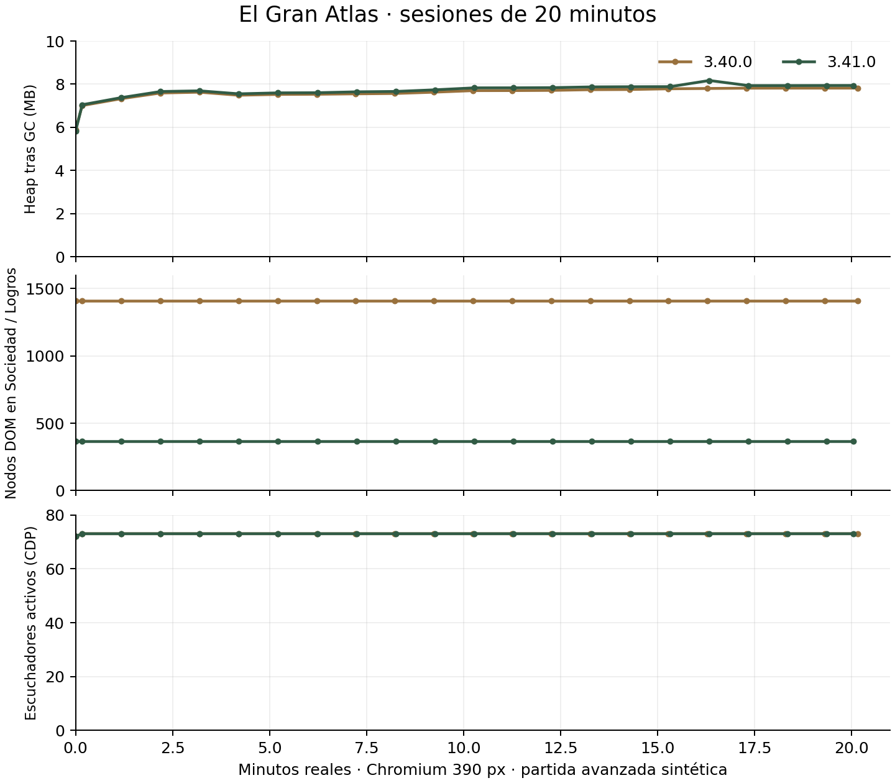

# UX-05 · Rendimiento y continuidad

La comparación usa ocho guardados sintéticos, diez módulos, 320/360/390/412/1280 px, el mismo Chromium y reloj congelado. Las latencias son del manejador síncrono medido con performance.now, sin transporte Playwright; no incluyen toda la presentación del siguiente frame ni representan teléfonos físicos. Las primeras mediciones concurrentes se conservan como evidencia de iteración, pero la tabla compara las series posteriores ejecutadas en orden.

| Sesión de 600 cambios + 200 persistencias | 3.40.0 | Candidato 3.41.0 |
|---|---:|---:|
| 390 px · P50 cambio | 4,1 ms | 5,3 ms |
| 390 px · P95 cambio | 10,7 ms | 13,2 ms |
| 390 px · 200 persistencias | 412,4 ms | 367,4 ms |
| 1280 px · P50 cambio | 3,7 ms | 5,1 ms |
| 1280 px · P95 cambio | 8,9 ms | 21,2 ms |
| 1280 px · 200 persistencias | 369,8 ms | 236,2 ms |

Hay una regresión medida al cambiar módulos, especialmente en la cola de latencia de escritorio. La orientación y restauración añaden trabajo; no se afirma una mejora general de velocidad. El coste de guardado de estas series baja, pero el almacenamiento varía entre ejecuciones y no se ha reducido ni debilitado la persistencia transaccional. El Bestiario conserva el mismo arte y paginación, sin una optimización nueva de sus SVG.

La Brújula ahora consulta las recompensas ya acreditadas por el motor y resuelve regiones, estudios y etapas de forma diferida: si ya hay un premio pendiente no construye los modelos que no usará. Sigue comprobando las decisiones contra las APIs reales. El tick existente actualiza solo la Brújula cuando cambia su proyección; incluye avistamientos, alimentación, dimorfismo y etapas de la región actual. No se crea otro intervalo ni se reconstruye Atlas por cada contador.

En ambas series, después de GC y 600 cambios hay 73 escuchadores activos y un solo intervalo. Los nodos CDP permanecen idénticos entre extremos: 529/528 en la base y 533/532 en el candidato. El contador acumulado de listeners añadidos no es memoria retenida. El heap pasa de 8,36 a 8,92 MB en la base de 390 px y de 8,52 a 9,16 MB en el candidato; por sí solo este incremento no prueba ni descarta una fuga.

[Base en serie](before-performance-controlled/report.json) · [Candidato optimizado](after-performance-final/report.json) · [Primera iteración concurrente](after-performance/report.json) · [Iteración previa a evaluación diferida](after-performance-controlled/report.json).

La [sesión base de tiempo real](session-before/report.json) completó 20 minutos con el tick original y 1.080 acciones de navegación, sin errores, desbordamiento ni crecimiento de escuchadores. Hay además una sesión de la interfaz UX-04 y una sesión final sobre el SHA-256 de app.js registrado en el informe. El cierre de publicación incorpora los resultados completos de la sesión final; no se presenta una ráfaga de cambios como tiempo real.

Las nueve tareas originales se repiten sin ocultar los recorridos que no se acortan: [después](after/report.json). Los atajos se miden desde un contexto relacionado ya abierto: Atlas→receta 6→2 interacciones y material→rutas 3→1. [Comparación real con la base](context-routes.json). La navegación manual principal conserva sus recorridos; no se crean diez pestañas nuevas ni se ejecuta automáticamente la operación al llegar.

Tres pruebas actuales comparan todos los catálogos, precios, recetas, rutas, fuentes de probabilidades y geometría con 0b48f60, y una misma secuencia económica con RNG fijo. Los resultados y la liquidación idempotente coinciden con la base. Se conservan como referencia las tres campañas mundiales de 3.40, además de comprobar la interpretación contextual de las diez etapas actuales.

La serie de diez módulos abre Sociedad en Subvenciones. Para medir explícitamente las listas extensas, se añade una [comparación de 30 aperturas de Logros y Misiones](society-performance.json): Logros pasa de 80 SVG/1.407 nodos a 8 SVG/366 nodos, P50 10,9→9,2 ms; Misiones de 37 tarjetas/1.079 nodos a 4 tarjetas/373 nodos, P50 6,4→6,8 ms y P95 7,9→10,9 ms. La reducción de DOM no implica que todas las latencias disminuyan.

## Cierre de sesiones de tiempo real

Las tres sesiones terminaron con más de 20 minutos reales: 1.080 cambios en la base y 1.071 en cada candidato, sin errores ni desbordamiento. El informe final registra el SHA-256 de app.js cargado y coincide con el manifiesto publicado. [Comparación y límites](sessions-comparison.json) · [Sesión final](session-final/report.json) · [Iteración UX-04](session-after/report.json).

Base 3.40: 1407 nodos constantes; escuchadores 72 al inicio y 73 al final, estabilizados en 73; un intervalo. Heap 5.88→7.82 MB; rango de los cinco últimos puntos 7.80–7.82 MB.

Final 3.41: 366 nodos constantes; escuchadores 72 al inicio y 73 al final, estabilizados en 73; un intervalo. Heap 5.81→7.94 MB; rango de los cinco últimos puntos 7.93–8.17 MB.

No se observa crecimiento sostenido del DOM ni de escuchadores en esta duración; una sesión de 20 minutos no garantiza ausencia de fugas en cualquier partida o dispositivo. La medición no altera almacenamiento ni reduce la frecuencia de guardado del juego.

